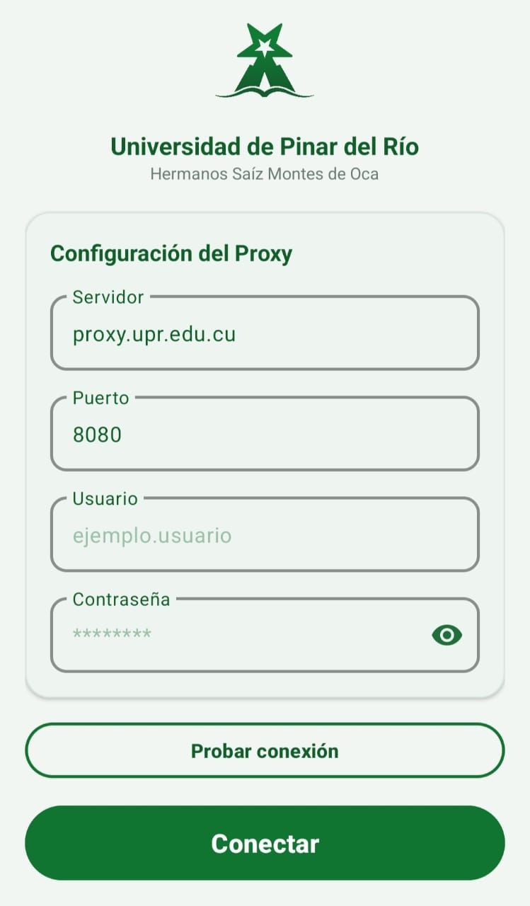

<div align="center">


# UPR Proxy

**Proxy corporativo para Android de la Universidad de Pinar del Río.**

[](https://github.com/storm2801/upr-proxy/actions/workflows/build.yml)
[](https://github.com/storm2801/upr-proxy/releases/latest)
[](LICENSE)

[Español](README.md) · [English](README_EN.md)

</div>

---

## ¿Qué es?

App Android que enruta **todo el tráfico del teléfono** por el proxy de la UPR (`proxy.upr.edu.cu:8080`) sin configurar nada en el WiFi.

## Compatibilidad

| | |
|---|---|
| ✅ **Android** | 8.0 o superior |
| ✅ **Arquitectura** | ARMv7 / ARM64 |
| ✅ **Red** | WiFi de la UPR |
| ❌ **No funciona** | iOS, Windows, macOS, Linux, Android TV |

## Captura

<div align="center">

</div>

## Instalación

**1. Descarga el APK**

https://github.com/storm2801/upr-proxy/releases/latest

**2. Desactiva Play Protect temporalmente**

Play Store → tu perfil → Play Protect → ⚙️ → desactivar "Analizar apps".

**3. Permite instalar apps desconocidas**

Ajustes → Aplicaciones → Acceso especial → Instalar apps desconocidas → elige tu navegador → activar.

**4. Instala el APK**

Gestor de archivos → Descargas → toca el APK → Instalar.

**5. Configura**

| Campo | Valor |
|---|---|
| Servidor | `proxy.upr.edu.cu` |
| Puerto | `8080` |
| Usuario | tu usuario UPR |
| Contraseña | tu contraseña del proxy |

Pulsa **Conectar** y acepta el permiso de VPN.

## Cómo funciona

La app crea una VPN local que captura todo el tráfico del teléfono, lo pasa por un puente SOCKS5 interno y lo envía al proxy de la UPR con autenticación Basic.

## Compilar

Requiere JDK 17 y Android SDK 34.

```bash
git clone https://github.com/storm2801/upr-proxy.git
cd upr-proxy
./gradlew assembleRelease
```

## Documentación

- [Instalación detallada](docs/INSTALL.md)
- [Arquitectura](docs/ARCHITECTURE.md)
- [Setup](docs/SETUP.md)
- [Ramas](docs/BRANCHES.md)
- [CI/CD](docs/CI-CD.md)

## Licencia

MIT — ver [LICENSE](LICENSE).

**Autor:** [@storm2801](https://github.com/storm2801)
