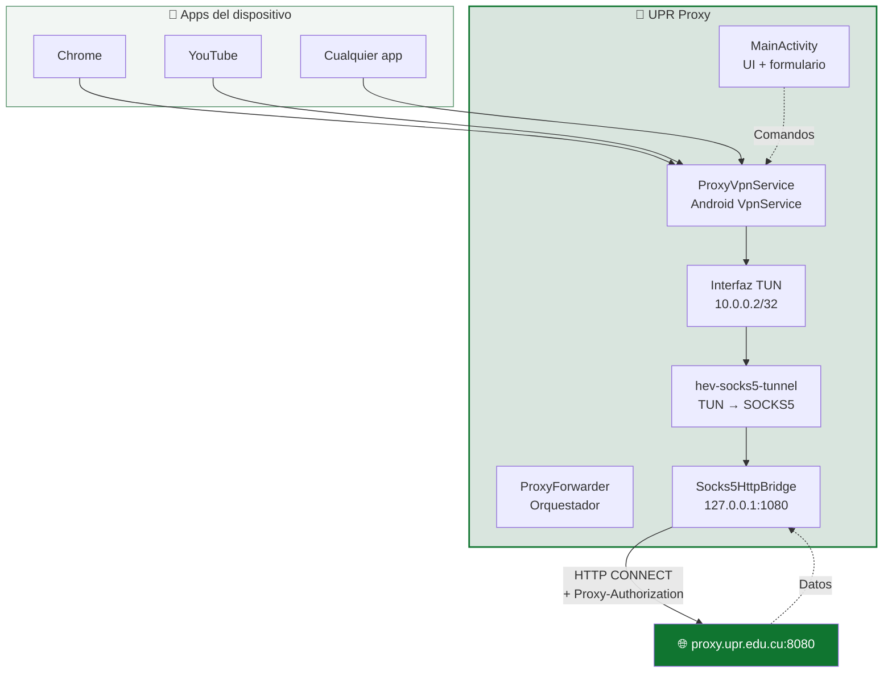

<div align="center">


# UPR Proxy

**Cliente proxy corporativo para Android, desarrollado para la Universidad de Pinar del Río "Hermanos Saíz Montes de Oca".**

[](https://github.com/storm2801/upr-proxy/actions/workflows/build.yml)
[](https://github.com/storm2801/upr-proxy/releases/latest)
[](LICENSE)
[](https://www.android.com)

[Español](README.md) · [English](README_EN.md)

</div>

---

## 📖 ¿Qué es?

**UPR Proxy** es una aplicación **exclusivamente para Android** que enruta **todo el tráfico del dispositivo** a través del proxy HTTP corporativo de la UPR (`proxy.upr.edu.cu:8080`) sin necesidad de configurar el proxy en cada red WiFi.

A diferencia de un proxy configurado a nivel de sistema —que solo afecta a apps que respetan la configuración global— esta app usa un `VpnService` para capturar **todo** el tráfico IP del dispositivo y redirigirlo a través del proxy, autenticándose con `Proxy-Authorization: Basic`.

**Ideal para:** estudiantes y personal que necesitan acceso a recursos académicos desde dispositivos móviles dentro de la red universitaria.

---

## ⚠️ Aviso importante antes de instalar

Esta app **NO está publicada en Google Play**, por lo que se distribuye como un **APK directo** desde GitHub. Esto implica que debes hacer algunos ajustes en tu teléfono antes de instalarla:

| ⚠️ Aviso ↕▾ | Detalle ↕▾ |
|---|---|
| 📱 **Solo Android** | No hay versión para iOS, Windows, macOS ni Linux. Es exclusiva para teléfonos y tablets Android. |
| 🔢 **Android 8.0 o superior** | Versiones anteriores (Android 7, 6, 5…) **no son compatibles**. |
| 🛡️ **Desactivar Play Protect temporalmente** | Google puede bloquear el APK por no venir de la tienda oficial. Ver [cómo hacerlo](#-cómo-desactivar-play-protect-temporalmente). |
| 🔓 **Permitir apps desconocidas** | Debes habilitar la instalación desde fuentes desconocidas para tu navegador o gestor de archivos. |
| 🌐 **Estar en la red UPR** | El proxy solo es alcanzable desde dentro de la red universitaria. |

---

## 📱 Compatibilidad

| Requisito ↕▾ | Mínimo ↕▾ | Recomendado ↕▾ |
|---|---|---|
| **Sistema operativo** | Android 8.0 (Oreo, API 26) | Android 12 o superior |
| **Arquitectura** | ARMv7 / ARM64 | ARM64 (arm64-v8a) |
| **Espacio libre** | ~15 MB | 50 MB |
| **RAM** | 1 GB | 2 GB o más |
| **Red** | WiFi UPR | WiFi UPR |

> ❌ **No compatible con:** iOS, Windows, macOS, Linux, Android TV, Wear OS, ChromeOS.
>
> ❌ **No compatible con Android 7.1 o anteriores.** Si tienes un dispositivo antiguo, la app no se instalará.

---

## 📥 Instalación paso a paso

Sigue estos pasos **en orden**. Si te saltas alguno, la instalación puede fallar.

### Paso 1 — Descargar el APK

Abre en el navegador del teléfono:

👉 **[https://github.com/storm2801/upr-proxy/releases/latest](https://github.com/storm2801/upr-proxy/releases/latest)**

En la sección **Assets** del Release más reciente, pulsa sobre:

```

UPRProxy-X.X.X-betaXX-release.apk

```

Espera a que termine la descarga (aproximadamente **4 MB**).

### Paso 2 — Desactivar Play Protect temporalmente

> ⚠️ Google Play Protect analiza todas las apps instaladas y puede **bloquear silenciosamente** este APK porque no viene de la tienda oficial. Desactívalo temporalmente antes de instalar.

1. Abre la app **Google Play Store**.
2. Toca tu **foto de perfil** en la esquina superior derecha.
3. Entra en **Play Protect**.
4. Toca el **icono de engranaje** ⚙️ (arriba a la derecha).
5. **Desactiva** la opción **"Analizar apps en busca de amenazas con Play Protect"**.
6. Confirma tocando **"Desactivar"** en el diálogo.

> 💡 Play Protect volverá a activarse solo en unos días. Si quieres reactivarlo inmediatamente después de instalar, vuelve al mismo menú y actívalo de nuevo.

### Paso 3 — Permitir instalar apps desconocidas

1. Abre **Ajustes** del teléfono.
2. Ve a **Aplicaciones** → **Acceso especial a aplicaciones** → **Instalar apps desconocidas**.
   *En algunos dispositivos la ruta es: **Ajustes** → **Seguridad** → **Instalar apps desconocidas**.*
3. Busca el navegador que usaste para descargar el APK (Chrome, Firefox, Samsung Internet…).
4. Activa el permiso **"Permitir desde esta fuente"**.

### Paso 4 — Instalar el APK

1. Abre el **gestor de archivos** del teléfono.
2. Ve a la carpeta **Descargas** (o donde se haya guardado el APK).
3. Toca sobre **`UPRProxy-X.X.X-betaXX-release.apk`**.
4. Android mostrará una advertencia: *"Por tu seguridad, tu teléfono no puede instalar apps desconocidas de esta fuente"*. Es normal — ya lo hemos habilitado en el paso 3.
5. Toca **Instalar**.
6. Espera a que termine (10-20 segundos).
7. Toca **Abrir**.

### Paso 5 — Reactivar Play Protect (opcional pero recomendado)

1. Vuelve a **Google Play Store** → **Play Protect** → ⚙️.
2. **Activa** de nuevo **"Analizar apps en busca de amenazas con Play Protect"**.
3. **No pasa nada** si Play Protect te avisa sobre UPR Proxy. Pulsa **"Instalar de todas formas"** o **"Mantener"** según lo que muestre.

### Paso 6 — Primer arranque

Al abrir la app por primera vez:

1. Verás el **onboarding de 3 pantallas**. Pulsa **Siguiente** hasta el final.
2. Rellena los campos:
   - **Servidor:** `proxy.upr.edu.cu`
   - **Puerto:** `8080`
   - **Usuario:** tu usuario institucional
   - **Contraseña:** tu contraseña del proxy
3. Pulsa **Conectar**.
4. Android pedirá permiso para crear una **VPN**. Acepta.
5. Listo ✅

---

## 🎯 Uso rápido

1. Conéctate al **WiFi de la universidad**.
2. Abre la app y rellena los datos (si no lo hiciste en el primer arranque).
3. Pulsa **Conectar**.
4. Verifica el estado en la tarjeta inferior: debe aparecer **Conectado** y el punto verde.

> 💡 Al minimizar la app, la VPN sigue activa en segundo plano y aparece una notificación persistente con el tráfico en vivo.

---

## 🩹 Solución de problemas

### ❌ "App no instalada"

- **Causa:** ya tienes una versión instalada con **firma diferente**.
- **Solución:** desinstala la versión anterior primero y vuelve a intentar.

### ❌ "Play Protect bloqueó la instalación"

- **Causa:** no desactivaste Play Protect antes de instalar.
- **Solución:** repite el [Paso 2](#paso-2--desactivar-play-protect-temporalmente) y vuelve a intentar.

### ❌ "No se puede abrir el archivo"

- **Causa:** el APK se descargó **incompleto** o **corrupto**.
- **Solución:** borra el archivo y vuelve a descargarlo. Verifica que el tamaño sea **~4 MB**.

### ❌ "Este dispositivo no es compatible"

- **Causa:** tu Android es **anterior a 8.0**.
- **Solución:** no hay solución, el dispositivo no es compatible con la app.

### ❌ La app se instala pero no conecta

- **Causa 1:** no estás en la red WiFi de la UPR.
- **Causa 2:** las credenciales son incorrectas.
- **Solución:** usa el botón **"Probar conexión"** de la pantalla principal para saber el motivo exacto.

### ❌ "La VPN no se desconecta"

- **Solución:** la app tiene un watchdog de 6 s. Si después de ese tiempo sigue activa, reinicia el teléfono y reporta el bug en [Issues](https://github.com/storm2801/upr-proxy/issues).

---

## ✨ Características

| Función ↕▾ | Descripción ↕▾ |
|---|---|
| 🔒 **Credenciales cifradas** | Se guardan con `EncryptedSharedPreferences` (AES-256-GCM, MasterKey del sistema). Nunca salen del dispositivo. |
| 🚀 **Un solo botón** | Conectar / Desconectar con verificación previa del proxy. |
| 📊 **Métricas en tiempo real** | Velocidad ↑↓, conexiones activas, datos totales, tiempo conectado y gráfico sparkline. |
| 🎨 **Diseño institucional** | Paleta de verdes oficial de la UPR, tema claro, splash nativo. |
| 🧭 **Onboarding guiado** | 3 pantallas de bienvenida para usuarios nuevos. |
| 🔄 **Auto-reconexión** | Detecta cambios de red y relanza la VPN automáticamente. |
| 🛡️ **Bloqueo de capturas** | `FLAG_SECURE` activo: previene screenshots y miniaturas. |
| ⚙️ **Auto-actualización** | Consulta un `version.json` público y ofrece descargar la nueva versión. |
| 🩺 **Diagnóstico avanzado** | Módulo de diagnóstico técnico para personal autorizado. |

---

## 📱 Capturas

<div align="center">

| Pantalla principal | Onboarding 1 | Onboarding 2 |
|---|---|---|
|  |  |  |

| Onboarding 3 | Icono |
|---|---|
|  |  |

</div>

> **Nota:** Reemplaza las rutas de `docs/screenshots/*.png` con las capturas que subas al repositorio.

---

## 🏗️ Arquitectura



👉 **Documentación completa:** [`docs/ARCHITECTURE.md`](https://docs/ARCHITECTURE.md)

---

## 🛠️ Compilar desde código

### Requisitos de desarrollo

- Linux (probado en Fedora / Ubuntu) o WSL.
- JDK **17** (Temurin recomendado).
- Android SDK: `platform 34` + `build-tools 34.0.0`.
- Git.

### Pasos rápidos

```
git clone https://github.com/storm2801/upr-proxy.git
cd upr-proxy
./gradlew assembleRelease
```

El APK firmado queda en `app/build/outputs/apk/release/app-release.apk`.

👉 **Guía completa de setup:** [`docs/SETUP.md`](https://docs/SETUP.md)

---

## 📂 Estructura del proyecto

```
upr-proxy/
├── app/
│   ├── build.gradle
│   └── src/main/
│       ├── AndroidManifest.xml
│       ├── java/com/upr/proxy/
│       └── res/
├── docs/
│   ├── INSTALL.md          # Guía de instalación extendida
│   ├── ARCHITECTURE.md
│   ├── SETUP.md
│   ├── BRANCHES.md
│   ├── CI-CD.md
│   └── screenshots/
├── scripts/
│   └── cleanup-branches.sh
├── .github/
│   ├── workflows/build.yml
│   ├── ISSUE_TEMPLATE/
│   └── PULL_REQUEST_TEMPLATE.md
├── CHANGELOG.md
├── CONTRIBUTING.md
├── SECURITY.md
├── CODE_OF_CONDUCT.md
├── LICENSE
├── README.md
├── README_EN.md
└── version.json
```

---

## 🌳 Ramas y versionado

| Rama ↕▾ | Propósito ↕▾ |
|---|---|
| `main` | Versiones estables y públicas. Cada commit aquí corresponde a un tag y un Release. |
| `develop` | Rama de integración. Todo lo nuevo pasa primero por aquí. |
| `feature/nombre` | Una funcionalidad o mejora por rama. |
| `fix/nombre` | Corrección puntual de un bug. |

👉 **Detalle completo:** [`docs/BRANCHES.md`](https://docs/BRANCHES.md)

---

## ⚙️ CI/CD

Cada vez que se empuja un tag `v*` a `main`, GitHub Actions compila el APK, crea un Release público y actualiza `version.json` automáticamente.

👉 **Documentación técnica:** [`docs/CI-CD.md`](https://docs/CI-CD.md)

---

## 🤝 Contribuir

Las contribuciones son bienvenidas. Por favor lee [`CONTRIBUTING.md`](https://contributing.md/) antes de abrir un PR.

- 🐛 [Reportar un bug](https://github.com/storm2801/upr-proxy/issues/new?template=bug_report.md)
- 💡 [Sugerir una función](https://github.com/storm2801/upr-proxy/issues/new?template=feature_request.md)
- 🔐 [Reportar un problema de seguridad](https://security.md/)

---

## 📜 Licencia

Distribuido bajo la licencia **MIT**. Consulta [`LICENSE`](https://license/) para más información.

---

## 👤 Autor

**storm2801** — [@storm2801](https://github.com/storm2801)

---
<div align="center">
Hecho con 💚 en Pinar del Río, Cuba
</div>
