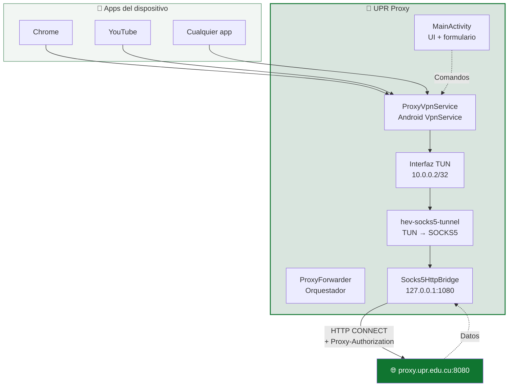

<div align="center">


# UPR Proxy

**Cliente proxy corporativo para Android, desarrollado para la Universidad de Pinar del Río "Hermanos Saíz Montes de Oca".**

[](https://github.com/storm2801/upr-proxy/actions/workflows/build.yml)
[](https://github.com/storm2801/upr-proxy/releases/latest)
[](LICENSE)

[Español](README.md) · [English](README_EN.md)

</div>

---

## 📖 ¿Qué es?

**UPR Proxy** es una aplicación Android que enruta **todo el tráfico del dispositivo** a través del proxy HTTP corporativo de la UPR (`proxy.upr.edu.cu:8080`) sin necesidad de configurar el proxy en cada red WiFi.

A diferencia de un proxy configurado a nivel de sistema —que solo afecta a apps que respetan la configuración global— esta app usa un `VpnService` para capturar **todo** el tráfico IP del dispositivo y redirigirlo a través del proxy, autenticándose con `Proxy-Authorization: Basic`.

**Ideal para:** estudiantes y personal que necesitan acceso a recursos académicos desde dispositivos móviles dentro de la red universitaria.

---

## ✨ Características

| Función ↕▾ | Descripción ↕▾ |
|---|---|
| 🔒 **Credenciales cifradas** | Se guardan con `EncryptedSharedPreferences` (AES-256-GCM, MasterKey del sistema). Nunca salen del dispositivo. |
| 🚀 **Un solo botón** | Conectar / Desconectar con verificación previa del proxy. |
| 📊 **Métricas en tiempo real** | Velocidad ↑↓, conexiones activas, datos totales, tiempo conectado y gráfico sparkline. |
| 🎨 **Diseño institucional** | Paleta de verdes oficial de la UPR, tema claro, splash nativo. |
| 🧭 **Onboarding guiado** | 3 pantallas de bienvenida para usuarios nuevos. |
| 🔄 **Auto-reconexión** | Detecta cambios de red y relanza la VPN automáticamente. |
| 🛡️ **Bloqueo de capturas** | `FLAG_SECURE` activo: previene screenshots y miniaturas. |
| ⚙️ **Auto-actualización** | Consulta un `version.json` público y ofrece descargar la nueva versión. |
| 🩺 **Diagnóstico avanzado** | Módulo de diagnóstico técnico para personal autorizado. |

---

## 📱 Capturas

<div align="center">

| Pantalla principal | Onboarding | Configuración |
|---|---|---|
|  |  |  |

| Onboarding — VPN | Onboarding — Listo | Icono |
|---|---|---|
|  |  |  |

</div>

> **Nota:** Reemplaza las rutas de `docs/screenshots/*.png` con las capturas que subas al repositorio.

---

## 🚀 Instalación

### Para usuarios

1. Descarga el último APK desde **[Releases](https://github.com/storm2801/upr-proxy/releases/latest)**.
2. Habilita "Instalar apps desconocidas" para tu navegador o gestor de archivos.
3. Instala el APK.
4. Al abrir la app por primera vez, sigue el onboarding.

### Requisitos

- Android **8.0 (Oreo, API 26)** o superior.
- Estar conectado a la **red WiFi de la UPR**.
- Credenciales del proxy corporativo (usuario y contraseña institucionales).

---

## 🎯 Uso rápido

1. Conéctate al WiFi de la universidad.
2. Abre la app y rellena:
   - **Servidor:** `proxy.upr.edu.cu`
   - **Puerto:** `8080`
   - **Usuario:** tu usuario institucional
   - **Contraseña:** tu contraseña del proxy
3. Pulsa **Conectar**.
4. Acepta el permiso de VPN cuando Android lo solicite.
5. Verifica el estado en la tarjeta inferior: debe aparecer **Conectado** y el punto verde.

> 💡 Al minimizar la app, la VPN sigue activa en segundo plano y aparece una notificación persistente con el tráfico en vivo.

---

## 🏗️ Arquitectura



**Cómo funciona:**

1. `ProxyVpnService` crea una interfaz de red virtual (TUN) que captura **todo** el tráfico IP.
2. `hev-socks5-tunnel` (librería nativa) lee paquetes del TUN y los entrega a un servidor SOCKS5 local.
3. `Socks5HttpBridge` atiende ese SOCKS5 y traduce cada conexión a un `CONNECT` HTTP hacia el proxy real con autenticación `Basic`.
4. Los datos de vuelta siguen el camino inverso hasta la app original.

👉 **Documentación completa:** [`docs/ARCHITECTURE.md`](https://docs/ARCHITECTURE.md)

---

## 🛠️ Compilar desde código

### Requisitos de desarrollo

- Linux (probado en Fedora / Ubuntu) o WSL.
- JDK **17** (Temurin recomendado).
- Android SDK: `platform 34` + `build-tools 34.0.0`.
- Git.

### Pasos rápidos

```
git clone https://github.com/storm2801/upr-proxy.git
cd upr-proxy
./gradlew assembleRelease
```

El APK firmado queda en:

```
app/build/outputs/apk/release/app-release.apk
```

👉 **Guía completa de setup:** [`docs/SETUP.md`](https://docs/SETUP.md)

---

## 📂 Estructura del proyecto

```
upr-proxy/
├── app/
│   ├── build.gradle
│   └── src/main/
│       ├── AndroidManifest.xml
│       ├── java/com/upr/proxy/       # Código Java
│       │   ├── MainActivity.java
│       │   ├── ProxyVpnService.java
│       │   ├── Socks5HttpBridge.java
│       │   ├── UpdateChecker.java
│       │   └── ...
│       └── res/                       # Recursos Android
│           ├── layout/
│           ├── drawable/
│           ├── values/
│           └── xml/
├── docs/                              # Documentación extendida
│   ├── ARCHITECTURE.md
│   ├── SETUP.md
│   ├── BRANCHES.md
│   ├── CI-CD.md
│   └── screenshots/
├── scripts/
│   └── cleanup-branches.sh
├── .github/
│   ├── workflows/build.yml
│   ├── ISSUE_TEMPLATE/
│   └── PULL_REQUEST_TEMPLATE.md
├── CHANGELOG.md
├── CONTRIBUTING.md
├── SECURITY.md
├── CODE_OF_CONDUCT.md
├── LICENSE
├── README.md
├── README_EN.md
└── version.json
```

---

## 🌳 Ramas y versionado

| Rama ↕▾ ↕▾ | Propósito ↕▾ ↕▾ |
|---|---|
| −`main` | Versiones estables y públicas. Cada commit aquí corresponde a un tag y un Release. |
| −`develop` | Rama de integración. Todo lo nuevo pasa primero por aquí. |
| −`feature/nombre` | Una funcionalidad o mejora por rama. |
| −`fix/nombre` | Corrección puntual de un bug. |
⚙

**Versionado:** [Semantic Versioning](https://semver.org/lang/es/) con sufijos tipo `1.0.0-betaN`.

👉 **Detalle completo:** [`docs/BRANCHES.md`](https://docs/BRANCHES.md)

---

## ⚙️ CI/CD

Cada vez que se empuja un tag `v*` a `main`, GitHub Actions:

1. Reconstruye el keystore desde los *Secrets*.
2. Compila el APK release firmado.
3. Crea un **Release público** en GitHub con el APK adjunto.
4. Actualiza `version.json` en `main` con los datos de la nueva versión.

👉 **Documentación técnica:** [`docs/CI-CD.md`](https://docs/CI-CD.md)

---

## 🤝 Contribuir

Las contribuciones son bienvenidas. Por favor lee [`CONTRIBUTING.md`](https://contributing.md/) antes de abrir un PR.

- 🐛 [Reportar un bug](https://github.com/storm2801/upr-proxy/issues/new?template=bug_report.md)
- 💡 [Sugerir una función](https://github.com/storm2801/upr-proxy/issues/new?template=feature_request.md)
- 🔐 [Reportar un problema de seguridad](https://security.md/)

---

## 📜 Licencia

Distribuido bajo la licencia **MIT**. Consulta [`LICENSE`](https://license/) para más información.

---

## 👤 Autor

**storm2801** — [@storm2801](https://github.com/storm2801)

---
<div align="center">
Hecho con 💚 en Pinar del Río, Cuba
</div>
