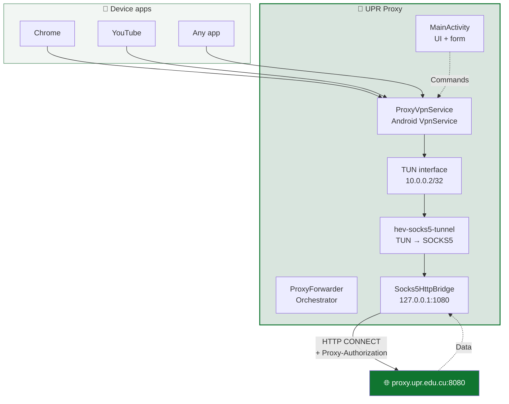

<div align="center">


# UPR Proxy

**Corporate proxy client for Android, built for the University of Pinar del Río "Hermanos Saíz Montes de Oca".**

[](https://github.com/storm2801/upr-proxy/actions/workflows/build.yml)
[](https://github.com/storm2801/upr-proxy/releases/latest)
[](LICENSE)

[Español](README.md) · [English](README_EN.md)

</div>

---

## 📖 What is it?

**UPR Proxy** is an Android app that routes **all device traffic** through the UPR corporate HTTP proxy (`proxy.upr.edu.cu:8080`) without the need to configure the proxy on every WiFi network.

Unlike a system-level proxy — which only affects apps that respect the global setting — this app uses a `VpnService` to capture **all** device IP traffic and redirect it through the proxy, authenticating with `Proxy-Authorization: Basic`.

**Best for:** students and staff who need to access academic resources from mobile devices inside the university network.

---

## ✨ Features

| Feature ↕▾ | Description ↕▾ |
|---|---|
| 🔒 **Encrypted credentials** | Stored with `EncryptedSharedPreferences` (AES-256-GCM, system MasterKey). Never leave the device. |
| 🚀 **One-button connect** | Connect / Disconnect with pre-flight proxy verification. |
| 📊 **Live metrics** | Speed ↑↓, active connections, total data, uptime, and a sparkline chart. |
| 🎨 **Institutional design** | Official UPR green palette, light theme, native splash screen. |
| 🧭 **Guided onboarding** | 3 welcome screens for new users. |
| 🔄 **Auto-reconnect** | Detects network changes and relaunches the VPN automatically. |
| 🛡️ **Screenshot blocking** | `FLAG_SECURE` enabled: prevents screenshots and thumbnails. |
| ⚙️ **Auto-update** | Checks a public `version.json` and offers to download the new version. |
| 🩺 **Advanced diagnostics** | Technical diagnostics module for authorized staff. |

---

## 📱 Screenshots

<div align="center">

| Main screen | Onboarding | Config |
|---|---|---|
|  |  |  |

| Onboarding — VPN | Onboarding — Ready | Icon |
|---|---|---|
|  |  |  |

</div>

> **Note:** Replace the `docs/screenshots/*.png` paths with the screenshots you upload to the repository.

---

## 🚀 Installation

### For users

1. Download the latest APK from **[Releases](https://github.com/storm2801/upr-proxy/releases/latest)**.
2. Enable "Install unknown apps" for your browser or file manager.
3. Install the APK.
4. On first launch, follow the onboarding.

### Requirements

- Android **8.0 (Oreo, API 26)** or later.
- Connected to the **UPR WiFi network**.
- Corporate proxy credentials (institutional username and password).

---

## 🎯 Quick start

1. Connect to the university WiFi.
2. Open the app and fill in:
   - **Server:** `proxy.upr.edu.cu`
   - **Port:** `8080`
   - **User:** your institutional username
   - **Password:** your proxy password
3. Tap **Connect**.
4. Accept the VPN permission when Android prompts you.
5. Check the status card below: it should show **Connected** and a green dot.

> 💡 When you minimize the app, the VPN stays active in the background with a persistent notification showing live traffic.

---

## 🏗️ Architecture



**How it works:**

1. `ProxyVpnService` creates a virtual network interface (TUN) that captures **all** IP traffic.
2. `hev-socks5-tunnel` (native library) reads packets from the TUN and feeds them to a local SOCKS5 server.
3. `Socks5HttpBridge` handles that SOCKS5 and translates each connection into an HTTP `CONNECT` to the real proxy with `Basic` authentication.
4. Response data follows the reverse path back to the original app.

👉 **Full documentation:** [`docs/ARCHITECTURE.md`](https://docs/ARCHITECTURE.md)

---

## 🛠️ Building from source

### Development requirements

- Linux (tested on Fedora / Ubuntu) or WSL.
- JDK **17** (Temurin recommended).
- Android SDK: `platform 34` + `build-tools 34.0.0`.
- Git.

### Quick steps

```
git clone https://github.com/storm2801/upr-proxy.git
cd upr-proxy
./gradlew assembleRelease
```

The signed APK will be at:

```
app/build/outputs/apk/release/app-release.apk
```

👉 **Full setup guide:** [`docs/SETUP.md`](https://docs/SETUP.md)

---

## 📂 Project structure

```
upr-proxy/
├── app/
│   ├── build.gradle
│   └── src/main/
│       ├── AndroidManifest.xml
│       ├── java/com/upr/proxy/       # Java source
│       │   ├── MainActivity.java
│       │   ├── ProxyVpnService.java
│       │   ├── Socks5HttpBridge.java
│       │   ├── UpdateChecker.java
│       │   └── ...
│       └── res/                       # Android resources
│           ├── layout/
│           ├── drawable/
│           ├── values/
│           └── xml/
├── docs/                              # Extended documentation
│   ├── ARCHITECTURE.md
│   ├── SETUP.md
│   ├── BRANCHES.md
│   ├── CI-CD.md
│   └── screenshots/
├── scripts/
│   └── cleanup-branches.sh
├── .github/
│   ├── workflows/build.yml
│   ├── ISSUE_TEMPLATE/
│   └── PULL_REQUEST_TEMPLATE.md
├── CHANGELOG.md
├── CONTRIBUTING.md
├── SECURITY.md
├── CODE_OF_CONDUCT.md
├── LICENSE
├── README.md
├── README_EN.md
└── version.json
```

---

## 🌳 Branches and versioning

| Branch ↕▾ ↕▾ | Purpose ↕▾ ↕▾ |
|---|---|
| −`main` | Stable, public versions. Every commit here corresponds to a tag and a Release. |
| −`develop` | Integration branch. Everything goes through here first. |
| −`feature/name` | One feature or improvement per branch. |
| −`fix/name` | Targeted bug fix. |
⚙

**Versioning:** [Semantic Versioning](https://semver.org/) with suffixes like `1.0.0-betaN`.

👉 **Full details:** [`docs/BRANCHES.md`](https://docs/BRANCHES.md)

---

## ⚙️ CI/CD

Every time a `v*` tag is pushed to `main`, GitHub Actions:

1. Rebuilds the keystore from *Secrets*.
2. Builds the signed release APK.
3. Creates a public **GitHub Release** with the APK attached.
4. Updates `version.json` on `main` with the new version data.

👉 **Technical documentation:** [`docs/CI-CD.md`](https://docs/CI-CD.md)

---

## 🤝 Contributing

Contributions are welcome. Please read [`CONTRIBUTING.md`](https://contributing.md/) before opening a PR.

- 🐛 [Report a bug](https://github.com/storm2801/upr-proxy/issues/new?template=bug_report.md)
- 💡 [Request a feature](https://github.com/storm2801/upr-proxy/issues/new?template=feature_request.md)
- 🔐 [Report a security issue](https://security.md/)

---

## 📜 License

Distributed under the **MIT** license. See [`LICENSE`](https://license/) for details.

---

## 👤 Author

**storm2801** — [@storm2801](https://github.com/storm2801)

---
<div align="center">
Made with 💚 in Pinar del Río, Cuba
</div>
