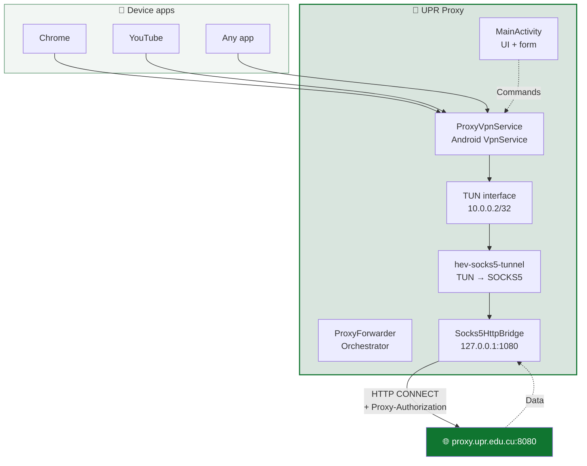

<div align="center">


# UPR Proxy

**Corporate proxy client for Android, built for the University of Pinar del Río "Hermanos Saíz Montes de Oca".**

[](https://github.com/storm2801/upr-proxy/actions/workflows/build.yml)
[](https://github.com/storm2801/upr-proxy/releases/latest)
[](LICENSE)
[](https://www.android.com)

[Español](README.md) · [English](README_EN.md)

</div>

---

## 📖 What is it?

**UPR Proxy** is an **Android-only** application that routes **all device traffic** through the UPR corporate HTTP proxy (`proxy.upr.edu.cu:8080`) without the need to configure the proxy on every WiFi network.

Unlike a system-level proxy — which only affects apps that respect the global setting — this app uses a `VpnService` to capture **all** device IP traffic and redirect it through the proxy, authenticating with `Proxy-Authorization: Basic`.

**Best for:** students and staff who need to access academic resources from mobile devices inside the university network.

---

## ⚠️ Important warning before installing

This app is **NOT published on Google Play**, so it's distributed as a **direct APK** from GitHub. This means you need to make a few adjustments on your phone before installing it:

| ⚠️ Warning ↕▾ | Detail ↕▾ |
|---|---|
| 📱 **Android only** | No iOS, Windows, macOS, or Linux version. It's exclusive to Android phones and tablets. |
| 🔢 **Android 8.0 or later** | Older versions (Android 7, 6, 5…) are **not supported**. |
| 🛡️ **Temporarily disable Play Protect** | Google may block the APK because it doesn't come from the official store. See [how to do it](#-how-to-temporarily-disable-play-protect). |
| 🔓 **Allow unknown apps** | You must enable installation from unknown sources for your browser or file manager. |
| 🌐 **Be on the UPR network** | The proxy is only reachable from inside the university network. |

---

## 📱 Compatibility

| Requirement ↕▾ | Minimum ↕▾ | Recommended ↕▾ |
|---|---|---|
| **OS** | Android 8.0 (Oreo, API 26) | Android 12 or later |
| **Architecture** | ARMv7 / ARM64 | ARM64 (arm64-v8a) |
| **Free space** | ~15 MB | 50 MB |
| **RAM** | 1 GB | 2 GB+ |
| **Network** | UPR WiFi | UPR WiFi |

> ❌ **Not compatible with:** iOS, Windows, macOS, Linux, Android TV, Wear OS, ChromeOS.
>
> ❌ **Not compatible with Android 7.1 or earlier.** If you have an old device, the app won't install.

---

## 📥 Step-by-step installation

Follow these steps **in order**. If you skip any, the installation may fail.

### Step 1 — Download the APK

Open on your phone's browser:

👉 **[https://github.com/storm2801/upr-proxy/releases/latest](https://github.com/storm2801/upr-proxy/releases/latest)**

In the **Assets** section of the latest Release, tap:

```

UPRProxy-X.X.X-betaXX-release.apk

```

Wait for the download to finish (about **4 MB**).

### Step 2 — Temporarily disable Play Protect

> ⚠️ Google Play Protect scans all installed apps and may **silently block** this APK because it doesn't come from the official store. Disable it temporarily before installing.

1. Open the **Google Play Store** app.
2. Tap your **profile picture** in the top right corner.
3. Go to **Play Protect**.
4. Tap the **gear icon** ⚙️ (top right).
5. **Disable** the **"Scan apps with Play Protect"** toggle.
6. Confirm by tapping **"Turn off"** in the dialog.

> 💡 Play Protect will re-enable itself automatically in a few days. If you want to re-enable it immediately after installing, go back to the same menu and turn it on.

### Step 3 — Allow installing unknown apps

1. Open your phone's **Settings**.
2. Go to **Apps** → **Special app access** → **Install unknown apps**.
   *On some devices: **Settings** → **Security** → **Install unknown apps**.*
3. Find the browser you used to download the APK (Chrome, Firefox, Samsung Internet…).
4. Enable the **"Allow from this source"** permission.

### Step 4 — Install the APK

1. Open your phone's **file manager**.
2. Go to the **Downloads** folder (or wherever the APK was saved).
3. Tap **`UPRProxy-X.X.X-betaXX-release.apk`**.
4. Android will show a warning: *"For your security, your phone is not allowed to install unknown apps from this source"*. This is normal — we already enabled it in step 3.
5. Tap **Install**.
6. Wait for it to finish (10-20 seconds).
7. Tap **Open**.

### Step 5 — Re-enable Play Protect (optional but recommended)

1. Go back to **Google Play Store** → **Play Protect** → ⚙️.
2. **Enable** **"Scan apps with Play Protect"** again.
3. **It's fine** if Play Protect warns you about UPR Proxy. Tap **"Install anyway"** or **"Keep"** depending on what it shows.

### Step 6 — First launch

When you open the app for the first time:

1. You'll see the **3-screen onboarding**. Tap **Next** until the end.
2. Fill in the fields:
   - **Server:** `proxy.upr.edu.cu`
   - **Port:** `8080`
   - **User:** your institutional username
   - **Password:** your proxy password
3. Tap **Connect**.
4. Android will ask for permission to create a **VPN**. Accept.
5. Done ✅

---

## 🎯 Quick start

1. Connect to the **university WiFi**.
2. Open the app and fill in the data (if you didn't during first launch).
3. Tap **Connect**.
4. Check the status card below: it should show **Connected** and a green dot.

> 💡 When you minimize the app, the VPN stays active in the background with a persistent notification showing live traffic.

---

## 🩹 Troubleshooting

### ❌ "App not installed"

- **Cause:** you already have a version installed with a **different signature**.
- **Solution:** uninstall the previous version first, then try again.

### ❌ "Play Protect blocked the installation"

- **Cause:** you didn't disable Play Protect before installing.
- **Solution:** repeat [Step 2](#step-2--temporarily-disable-play-protect) and try again.

### ❌ "Can't open the file"

- **Cause:** the APK was downloaded **incomplete** or **corrupted**.
- **Solution:** delete the file and download it again. Verify the size is **~4 MB**.

### ❌ "This device is not compatible"

- **Cause:** your Android is **older than 8.0**.
- **Solution:** no solution — the device isn't compatible with the app.

### ❌ The app installs but won't connect

- **Cause 1:** you're not on the UPR WiFi network.
- **Cause 2:** the credentials are wrong.
- **Solution:** use the **"Test connection"** button on the main screen to find out the exact reason.

### ❌ "The VPN won't disconnect"

- **Solution:** the app has a 6-second watchdog. If it's still active after that, restart your phone and report the bug on [Issues](https://github.com/storm2801/upr-proxy/issues).

---

## ✨ Features

| Feature ↕▾ | Description ↕▾ |
|---|---|
| 🔒 **Encrypted credentials** | Stored with `EncryptedSharedPreferences` (AES-256-GCM, system MasterKey). Never leave the device. |
| 🚀 **One-button connect** | Connect / Disconnect with pre-flight proxy verification. |
| 📊 **Live metrics** | Speed ↑↓, active connections, total data, uptime, and a sparkline chart. |
| 🎨 **Institutional design** | Official UPR green palette, light theme, native splash screen. |
| 🧭 **Guided onboarding** | 3 welcome screens for new users. |
| 🔄 **Auto-reconnect** | Detects network changes and relaunches the VPN automatically. |
| 🛡️ **Screenshot blocking** | `FLAG_SECURE` enabled: prevents screenshots and thumbnails. |
| ⚙️ **Auto-update** | Checks a public `version.json` and offers to download the new version. |
| 🩺 **Advanced diagnostics** | Technical diagnostics module for authorized staff. |

---

## 📱 Screenshots

<div align="center">

| Main screen | Onboarding 1 | Onboarding 2 |
|---|---|---|
|  |  |  |

| Onboarding 3 | Icon |
|---|---|
|  |  |

</div>

> **Note:** Replace the `docs/screenshots/*.png` paths with the screenshots you upload to the repository.

---

## 🏗️ Architecture



👉 **Full documentation:** [`docs/ARCHITECTURE.md`](https://docs/ARCHITECTURE.md)

---

## 🛠️ Building from source

### Development requirements

- Linux (tested on Fedora / Ubuntu) or WSL.
- JDK **17** (Temurin recommended).
- Android SDK: `platform 34` + `build-tools 34.0.0`.
- Git.

### Quick steps

```
git clone https://github.com/storm2801/upr-proxy.git
cd upr-proxy
./gradlew assembleRelease
```

The signed APK will be at `app/build/outputs/apk/release/app-release.apk`.

👉 **Full setup guide:** [`docs/SETUP.md`](https://docs/SETUP.md)

---

## 📂 Project structure

```
upr-proxy/
├── app/
│   ├── build.gradle
│   └── src/main/
│       ├── AndroidManifest.xml
│       ├── java/com/upr/proxy/
│       └── res/
├── docs/
│   ├── INSTALL.md          # Extended installation guide
│   ├── ARCHITECTURE.md
│   ├── SETUP.md
│   ├── BRANCHES.md
│   ├── CI-CD.md
│   └── screenshots/
├── scripts/
│   └── cleanup-branches.sh
├── .github/
│   ├── workflows/build.yml
│   ├── ISSUE_TEMPLATE/
│   └── PULL_REQUEST_TEMPLATE.md
├── CHANGELOG.md
├── CONTRIBUTING.md
├── SECURITY.md
├── CODE_OF_CONDUCT.md
├── LICENSE
├── README.md
├── README_EN.md
└── version.json
```

---

## 🌳 Branches and versioning

| Branch ↕▾ ↕▾ | Purpose ↕▾ ↕▾ |
|---|---|
| −`main` | Stable, public versions. Every commit here corresponds to a tag and a Release. |
| −`develop` | Integration branch. Everything goes through here first. |
| `feature/name` | One feature or improvement per branch. |
| `fix/name` | Targeted bug fix. |
⚙

👉 **Full details:** [`docs/BRANCHES.md`](https://docs/BRANCHES.md)

---

## ⚙️ CI/CD

Every time a `v*` tag is pushed to `main`, GitHub Actions builds the APK, creates a public Release, and updates `version.json` automatically.

👉 **Technical documentation:** [`docs/CI-CD.md`](https://docs/CI-CD.md)

---

## 🤝 Contributing

Contributions are welcome. Please read [`CONTRIBUTING.md`](https://contributing.md/) before opening a PR.

- 🐛 [Report a bug](https://github.com/storm2801/upr-proxy/issues/new?template=bug_report.md)
- 💡 [Request a feature](https://github.com/storm2801/upr-proxy/issues/new?template=feature_request.md)
- 🔐 [Report a security issue](https://security.md/)

---

## 📜 License

Distributed under the **MIT** license. See [`LICENSE`](https://license/) for details.

---

## 👤 Author

**storm2801** — [@storm2801](https://github.com/storm2801)

---
<div align="center">
Made with 💚 in Pinar del Río, Cuba
</div>
