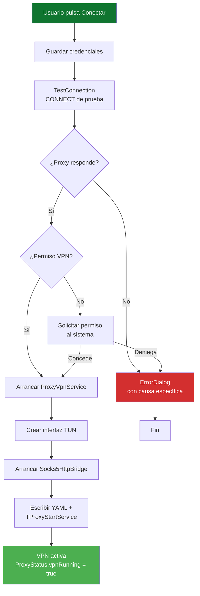

# Arquitectura de UPR Proxy

Este documento describe cómo funciona la app por dentro: los
componentes principales, cómo se comunican, y el flujo de datos desde
que el usuario pulsa **Conectar** hasta que el tráfico sale por el
proxy de la UPR.

---

## 📐 Visión general

La app **no** utiliza la configuración de proxy del sistema operativo
(que solo afecta a apps que la respetan). En su lugar, crea una **VPN
local** que captura todo el tráfico IP del dispositivo y lo redirige a
través del proxy HTTP corporativo.

```

┌─────────────────────────────────────────────────────────────┐
│                      Dispositivo Android                     │
│                                                             │
│  ┌─────────┐   ┌──────────────┐   ┌─────────────────────┐  │
│  │  Chrome │   │   YouTube    │   │   Otras apps        │  │
│  └────┬────┘   └──────┬───────┘   └──────────┬──────────┘  │
│       │               │                       │             │
│       └───────────────┴───────────────────────┘             │
│                       │  Paquetes IP                        │
│                       ▼                                     │
│              ┌──────────────────┐                           │
│              │  Interfaz TUN    │  (creada por VpnService)  │
│              │  10.0.0.2/32     │                           │
│              └────────┬─────────┘                           │
│                       │                                     │
│                       ▼                                     │
│              ┌──────────────────┐                           │
│              │ hev-socks5-tunnel│  (librería nativa)        │
│              └────────┬─────────┘                           │
│                       │  SOCKS5                             │
│                       ▼                                     │
│              ┌──────────────────┐                           │
│              │ Socks5HttpBridge │  127.0.0.1:1080           │
│              └────────┬─────────┘                           │
└───────────────────────┼─────────────────────────────────────┘
│  HTTP CONNECT + Basic Auth
▼
┌────────────────────────────┐
│  [proxy.upr.edu.cu:8080](https://proxy.upr.edu.cu:8080/)     │
└────────────────────────────┘

```

---

## 🧩 Componentes

### `MainActivity`

Interfaz principal. Se encarga de:

- Mostrar el formulario (servidor, puerto, usuario, contraseña).
- Verificar el proxy antes de conectar (`TestConnection`).
- Pedir permiso de VPN al sistema (`VpnService.prepare`).
- Lanzar y detener `ProxyVpnService`.
- Mostrar métricas en vivo (velocidad, conexiones, datos, uptime).
- Comprobar actualizaciones al abrir la app.

### `ProxyVpnService`

Extiende `android.net.VpnService`. Es el **corazón de la app**.

- Crea la interfaz TUN con `Builder`:
  - Dirección local: `10.0.0.2/32`
  - Ruta: `0.0.0.0/0` (todo el tráfico)
  - Excluye la propia app con `addDisallowedApplication`
- Arranca `ProxyForwarder` en un hilo separado.
- Mantiene una notificación persistente con las métricas.
- Gestiona el ciclo de vida: `onStartCommand`, `onRevoke`, `onDestroy`.

### `ProxyForwarder`

Orquestador. Se ejecuta en un hilo de fondo (`upr-proxy-forwarder`).
Sus responsabilidades:

1. Arrancar el puente `Socks5HttpBridge`.
2. Escribir el archivo de configuración YAML de `hev-socks5-tunnel`.
3. Llamar a `TProxyStartService(configPath, tunFd)`.
4. Al detenerse, llamar a `TProxyStopService()` con timeout de 3 s.

### `Socks5HttpBridge`

Servidor SOCKS5 local escuchando en `127.0.0.1:1080`.

Para cada conexión SOCKS5 entrante:

1. Lee el *handshake* SOCKS5 (método 0x00, sin auth).
2. Lee la petición `CONNECT host:port`.
3. Abre una conexión TCP al proxy HTTP real.
4. Envía `CONNECT host:port HTTP/1.1` con cabecera
   `Proxy-Authorization: Basic <base64(user:pass)>`.
5. Espera el `200 OK` del proxy.
6. Responde al cliente SOCKS5 con éxito.
7. Hace *pipe* bidireccional entre los sockets.

Mantiene un contador de conexiones activas y bytes enviados/recibidos
en `ProxyStatus`.

### `ProxyStatus`

Estado global estático (thread-safe con `Atomic*`). Almacena:

- `vpnRunning` (bool)
- `activeConnections`, `totalConnections` (int)
- `bytesSent`, `bytesReceived` (long)
- `serverHost`, `serverPort`
- `startedAt`
- Velocidades calculadas (`speedUpBps`, `speedDownBps`)

Todos los componentes leen y escriben aquí para mostrar el estado en
vivo sin necesidad de `Binder` o `Messenger`.

### `TestConnection`

Hace un `CONNECT` de prueba a `www.google.com:443` **sin activar la
VPN**. Sirve para:

- Validar credenciales antes de conectar.
- Verificar que el proxy es alcanzable.
- Distinguir entre errores de red, DNS, autenticación y timeout.

### `SecurePrefs`

Envoltorio de `EncryptedSharedPreferences`. Almacena:

- Servidor, puerto, usuario, contraseña.
- Flags internos (`onboarding_done`, `developer_mode`, etc.).

Migra automáticamente datos del almacén antiguo en texto plano la
primera vez que se ejecuta.

### Sistema de actualización

- `UpdateChecker`: descarga `version.json` desde
  `raw.githubusercontent.com/storm2801/upr-proxy/main/version.json` y
  compara `versionCode`.
- `UpdateDownloader`: descarga el APK a `cacheDir/updates/`.
- `UpdateDialog`: muestra el diálogo bonito y abre el instalador vía
  `FileProvider`.

### Logging

- `LogBuffer`: buffer circular en memoria (1000 líneas máx.). Notifica
  a listeners registrados.
- `L`: wrapper de `android.util.Log` que además escribe en
  `LogBuffer`.
- `LogsActivity`: muestra los logs en vivo con filtros por nivel.

---

## 🔄 Flujo de conexión



---

## 🌊 Ciclo de vida de una petición

Ejemplo: abres Chrome y entras a `https://www.google.com`.
<svg id="mermaid-svg-18" width="100%" xmlns="http://www.w3.org/2000/svg" style="max-width: 100%; display: block; transform-origin: 0px 0px 0px; user-select: none; transform: translate(0.000162598px) scale(1);" viewBox="-115.4 -75.4 2023.8000000000002 1438.8000000000002" role="graphics-document document" height="100%" class="undefined mermaid-svg"><g><rect x="1643" y="1222" fill="#eaeaea" stroke="#666" width="150" height="65" name="Google" rx="3" ry="3" class="actor actor-bottom"></rect><text x="1718" y="1254.5" style="text-anchor: middle; font-size: 16px; font-weight: 400;" dominant-baseline="central" alignment-baseline="central" class="actor actor-box"><tspan x="1718" dy="0">☁️ Google</tspan></text></g><g><rect x="1410" y="1222" fill="#eaeaea" stroke="#666" width="150" height="65" name="Proxy" rx="3" ry="3" class="actor actor-bottom"></rect><text x="1485" y="1254.5" style="text-anchor: middle; font-size: 16px; font-weight: 400;" dominant-baseline="central" alignment-baseline="central" class="actor actor-box"><tspan x="1485" dy="0">🟢 Proxy UPR</tspan></text></g><g><rect x="1042" y="1222" fill="#eaeaea" stroke="#666" width="182" height="65" name="S5" rx="3" ry="3" class="actor actor-bottom"></rect><text x="1133" y="1254.5" style="text-anchor: middle; font-size: 16px; font-weight: 400;" dominant-baseline="central" alignment-baseline="central" class="actor actor-box"><tspan x="1133" dy="0">🔵 Socks5HttpBridge</tspan></text></g><g><rect x="691.5" y="1222" fill="#eaeaea" stroke="#666" width="187" height="65" name="HEV" rx="3" ry="3" class="actor actor-bottom"></rect><text x="785" y="1254.5" style="text-anchor: middle; font-size: 16px; font-weight: 400;" dominant-baseline="central" alignment-baseline="central" class="actor actor-box"><tspan x="785" dy="0">⚙️ hev-socks5-tunnel</tspan></text></g><g><rect x="335" y="1222" fill="#eaeaea" stroke="#666" width="150" height="65" name="TUN" rx="3" ry="3" class="actor actor-bottom"></rect><text x="410" y="1254.5" style="text-anchor: middle; font-size: 16px; font-weight: 400;" dominant-baseline="central" alignment-baseline="central" class="actor actor-box"><tspan x="410" dy="0">📡 Interfaz TUN</tspan></text></g><g><rect x="0" y="1222" fill="#eaeaea" stroke="#666" width="150" height="65" name="App" rx="3" ry="3" class="actor actor-bottom"></rect><text x="75" y="1254.5" style="text-anchor: middle; font-size: 16px; font-weight: 400;" dominant-baseline="central" alignment-baseline="central" class="actor actor-box"><tspan x="75" dy="0">🌐 Chrome</tspan></text></g><g><line id="actor52" x1="1718" y1="65" x2="1718" y2="1222" class="actor-line 200" stroke-width="0.5px" stroke="#999" name="Google"></line><g id="root-52"><rect x="1643" y="0" fill="#eaeaea" stroke="#666" width="150" height="65" name="Google" rx="3" ry="3" class="actor actor-top"></rect><text x="1718" y="32.5" style="text-anchor: middle; font-size: 16px; font-weight: 400;" dominant-baseline="central" alignment-baseline="central" class="actor actor-box"><tspan x="1718" dy="0">☁️ Google</tspan></text></g></g><g><line id="actor51" x1="1485" y1="65" x2="1485" y2="1222" class="actor-line 200" stroke-width="0.5px" stroke="#999" name="Proxy"></line><g id="root-51"><rect x="1410" y="0" fill="#eaeaea" stroke="#666" width="150" height="65" name="Proxy" rx="3" ry="3" class="actor actor-top"></rect><text x="1485" y="32.5" style="text-anchor: middle; font-size: 16px; font-weight: 400;" dominant-baseline="central" alignment-baseline="central" class="actor actor-box"><tspan x="1485" dy="0">🟢 Proxy UPR</tspan></text></g></g><g><line id="actor50" x1="1133" y1="65" x2="1133" y2="1222" class="actor-line 200" stroke-width="0.5px" stroke="#999" name="S5"></line><g id="root-50"><rect x="1042" y="0" fill="#eaeaea" stroke="#666" width="182" height="65" name="S5" rx="3" ry="3" class="actor actor-top"></rect><text x="1133" y="32.5" style="text-anchor: middle; font-size: 16px; font-weight: 400;" dominant-baseline="central" alignment-baseline="central" class="actor actor-box"><tspan x="1133" dy="0">🔵 Socks5HttpBridge</tspan></text></g></g><g><line id="actor49" x1="785" y1="65" x2="785" y2="1222" class="actor-line 200" stroke-width="0.5px" stroke="#999" name="HEV"></line><g id="root-49"><rect x="691.5" y="0" fill="#eaeaea" stroke="#666" width="187" height="65" name="HEV" rx="3" ry="3" class="actor actor-top"></rect><text x="785" y="32.5" style="text-anchor: middle; font-size: 16px; font-weight: 400;" dominant-baseline="central" alignment-baseline="central" class="actor actor-box"><tspan x="785" dy="0">⚙️ hev-socks5-tunnel</tspan></text></g></g><g><line id="actor48" x1="410" y1="65" x2="410" y2="1222" class="actor-line 200" stroke-width="0.5px" stroke="#999" name="TUN"></line><g id="root-48"><rect x="335" y="0" fill="#eaeaea" stroke="#666" width="150" height="65" name="TUN" rx="3" ry="3" class="actor actor-top"></rect><text x="410" y="32.5" style="text-anchor: middle; font-size: 16px; font-weight: 400;" dominant-baseline="central" alignment-baseline="central" class="actor actor-box"><tspan x="410" dy="0">📡 Interfaz TUN</tspan></text></g></g><g><line id="actor47" x1="75" y1="65" x2="75" y2="1222" class="actor-line 200" stroke-width="0.5px" stroke="#999" name="App"></line><g id="root-47"><rect x="0" y="0" fill="#eaeaea" stroke="#666" width="150" height="65" name="App" rx="3" ry="3" class="actor actor-top"></rect><text x="75" y="32.5" style="text-anchor: middle; font-size: 16px; font-weight: 400;" dominant-baseline="central" alignment-baseline="central" class="actor actor-box"><tspan x="75" dy="0">🌐 Chrome</tspan></text></g></g><style>#mermaid-svg-18{font-family:"trebuchet ms",verdana,arial,sans-serif;font-size:16px;fill:#ccc;}@keyframes edge-animation-frame{from{stroke-dashoffset:0;}}@keyframes dash{to{stroke-dashoffset:0;}}#mermaid-svg-18 .edge-animation-slow{stroke-dasharray:9,5!important;stroke-dashoffset:900;animation:dash 50s linear infinite;stroke-linecap:round;}#mermaid-svg-18 .edge-animation-fast{stroke-dasharray:9,5!important;stroke-dashoffset:900;animation:dash 20s linear infinite;stroke-linecap:round;}#mermaid-svg-18 .error-icon{fill:#a44141;}#mermaid-svg-18 .error-text{fill:#ddd;stroke:#ddd;}#mermaid-svg-18 .edge-thickness-normal{stroke-width:1px;}#mermaid-svg-18 .edge-thickness-thick{stroke-width:3.5px;}#mermaid-svg-18 .edge-pattern-solid{stroke-dasharray:0;}#mermaid-svg-18 .edge-thickness-invisible{stroke-width:0;fill:none;}#mermaid-svg-18 .edge-pattern-dashed{stroke-dasharray:3;}#mermaid-svg-18 .edge-pattern-dotted{stroke-dasharray:2;}#mermaid-svg-18 .marker{fill:lightgrey;stroke:lightgrey;}#mermaid-svg-18 .marker.cross{stroke:lightgrey;}#mermaid-svg-18 svg{font-family:"trebuchet ms",verdana,arial,sans-serif;font-size:16px;}#mermaid-svg-18 p{margin:0;}#mermaid-svg-18 .actor{stroke:#ccc;fill:#1f2020;}#mermaid-svg-18 text.actor&gt;tspan{fill:lightgrey;stroke:none;}#mermaid-svg-18 .actor-line{stroke:#ccc;}#mermaid-svg-18 .messageLine0{stroke-width:1.5;stroke-dasharray:none;stroke:lightgrey;}#mermaid-svg-18 .messageLine1{stroke-width:1.5;stroke-dasharray:2,2;stroke:lightgrey;}#mermaid-svg-18 #arrowhead path{fill:lightgrey;stroke:lightgrey;}#mermaid-svg-18 .sequenceNumber{fill:black;}#mermaid-svg-18 #sequencenumber{fill:lightgrey;}#mermaid-svg-18 #crosshead path{fill:lightgrey;stroke:lightgrey;}#mermaid-svg-18 .messageText{fill:lightgrey;stroke:none;}#mermaid-svg-18 .labelBox{stroke:#ccc;fill:#1f2020;}#mermaid-svg-18 .labelText,#mermaid-svg-18 .labelText&gt;tspan{fill:lightgrey;stroke:none;}#mermaid-svg-18 .loopText,#mermaid-svg-18 .loopText&gt;tspan{fill:lightgrey;stroke:none;}#mermaid-svg-18 .loopLine{stroke-width:2px;stroke-dasharray:2,2;stroke:#ccc;fill:#ccc;}#mermaid-svg-18 .note{stroke:hsl(180, 0%, 18.3529411765%);fill:hsl(180, 1.5873015873%, 28.3529411765%);}#mermaid-svg-18 .noteText,#mermaid-svg-18 .noteText&gt;tspan{fill:rgb(183.8476190475, 181.5523809523, 181.5523809523);stroke:none;}#mermaid-svg-18 .activation0{fill:hsl(180, 1.5873015873%, 28.3529411765%);stroke:#ccc;}#mermaid-svg-18 .activation1{fill:hsl(180, 1.5873015873%, 28.3529411765%);stroke:#ccc;}#mermaid-svg-18 .activation2{fill:hsl(180, 1.5873015873%, 28.3529411765%);stroke:#ccc;}#mermaid-svg-18 .actorPopupMenu{position:absolute;}#mermaid-svg-18 .actorPopupMenuPanel{position:absolute;fill:#1f2020;box-shadow:0px 8px 16px 0px rgba(0,0,0,0.2);filter:drop-shadow(3px 5px 2px rgb(0 0 0 / 0.4));}#mermaid-svg-18 .actor-man line{stroke:#ccc;fill:#1f2020;}#mermaid-svg-18 .actor-man circle,#mermaid-svg-18 line{stroke:#ccc;fill:#1f2020;stroke-width:2px;}#mermaid-svg-18 :root{--mermaid-font-family:"trebuchet ms",verdana,arial,sans-serif;}</style><g></g><defs><symbol id="computer" width="24" height="24"><path transform="scale(.5)" d="M2 2v13h20v-13h-20zm18 11h-16v-9h16v9zm-10.228 6l.466-1h3.524l.467 1h-4.457zm14.228 3h-24l2-6h2.104l-1.33 4h18.45l-1.297-4h2.073l2 6zm-5-10h-14v-7h14v7z"></path></symbol></defs><defs><symbol id="database" fill-rule="evenodd" clip-rule="evenodd"><path transform="scale(.5)" d="M12.258.001l.256.004.255.005.253.008.251.01.249.012.247.015.246.016.242.019.241.02.239.023.236.024.233.027.231.028.229.031.225.032.223.034.22.036.217.038.214.04.211.041.208.043.205.045.201.046.198.048.194.05.191.051.187.053.183.054.18.056.175.057.172.059.168.06.163.061.16.063.155.064.15.066.074.033.073.033.071.034.07.034.069.035.068.035.067.035.066.035.064.036.064.036.062.036.06.036.06.037.058.037.058.037.055.038.055.038.053.038.052.038.051.039.05.039.048.039.047.039.045.04.044.04.043.04.041.04.04.041.039.041.037.041.036.041.034.041.033.042.032.042.03.042.029.042.027.042.026.043.024.043.023.043.021.043.02.043.018.044.017.043.015.044.013.044.012.044.011.045.009.044.007.045.006.045.004.045.002.045.001.045v17l-.001.045-.002.045-.004.045-.006.045-.007.045-.009.044-.011.045-.012.044-.013.044-.015.044-.017.043-.018.044-.02.043-.021.043-.023.043-.024.043-.026.043-.027.042-.029.042-.03.042-.032.042-.033.042-.034.041-.036.041-.037.041-.039.041-.04.041-.041.04-.043.04-.044.04-.045.04-.047.039-.048.039-.05.039-.051.039-.052.038-.053.038-.055.038-.055.038-.058.037-.058.037-.06.037-.06.036-.062.036-.064.036-.064.036-.066.035-.067.035-.068.035-.069.035-.07.034-.071.034-.073.033-.074.033-.15.066-.155.064-.16.063-.163.061-.168.06-.172.059-.175.057-.18.056-.183.054-.187.053-.191.051-.194.05-.198.048-.201.046-.205.045-.208.043-.211.041-.214.04-.217.038-.22.036-.223.034-.225.032-.229.031-.231.028-.233.027-.236.024-.239.023-.241.02-.242.019-.246.016-.247.015-.249.012-.251.01-.253.008-.255.005-.256.004-.258.001-.258-.001-.256-.004-.255-.005-.253-.008-.251-.01-.249-.012-.247-.015-.245-.016-.243-.019-.241-.02-.238-.023-.236-.024-.234-.027-.231-.028-.228-.031-.226-.032-.223-.034-.22-.036-.217-.038-.214-.04-.211-.041-.208-.043-.204-.045-.201-.046-.198-.048-.195-.05-.19-.051-.187-.053-.184-.054-.179-.056-.176-.057-.172-.059-.167-.06-.164-.061-.159-.063-.155-.064-.151-.066-.074-.033-.072-.033-.072-.034-.07-.034-.069-.035-.068-.035-.067-.035-.066-.035-.064-.036-.063-.036-.062-.036-.061-.036-.06-.037-.058-.037-.057-.037-.056-.038-.055-.038-.053-.038-.052-.038-.051-.039-.049-.039-.049-.039-.046-.039-.046-.04-.044-.04-.043-.04-.041-.04-.04-.041-.039-.041-.037-.041-.036-.041-.034-.041-.033-.042-.032-.042-.03-.042-.029-.042-.027-.042-.026-.043-.024-.043-.023-.043-.021-.043-.02-.043-.018-.044-.017-.043-.015-.044-.013-.044-.012-.044-.011-.045-.009-.044-.007-.045-.006-.045-.004-.045-.002-.045-.001-.045v-17l.001-.045.002-.045.004-.045.006-.045.007-.045.009-.044.011-.045.012-.044.013-.044.015-.044.017-.043.018-.044.02-.043.021-.043.023-.043.024-.043.026-.043.027-.042.029-.042.03-.042.032-.042.033-.042.034-.041.036-.041.037-.041.039-.041.04-.041.041-.04.043-.04.044-.04.046-.04.046-.039.049-.039.049-.039.051-.039.052-.038.053-.038.055-.038.056-.038.057-.037.058-.037.06-.037.061-.036.062-.036.063-.036.064-.036.066-.035.067-.035.068-.035.069-.035.07-.034.072-.034.072-.033.074-.033.151-.066.155-.064.159-.063.164-.061.167-.06.172-.059.176-.057.179-.056.184-.054.187-.053.19-.051.195-.05.198-.048.201-.046.204-.045.208-.043.211-.041.214-.04.217-.038.22-.036.223-.034.226-.032.228-.031.231-.028.234-.027.236-.024.238-.023.241-.02.243-.019.245-.016.247-.015.249-.012.251-.01.253-.008.255-.005.256-.004.258-.001.258.001zm-9.258 20.499v.01l.001.021.003.021.004.022.005.021.006.022.007.022.009.023.01.022.011.023.012.023.013.023.015.023.016.024.017.023.018.024.019.024.021.024.022.025.023.024.024.025.052.049.056.05.061.051.066.051.07.051.075.051.079.052.084.052.088.052.092.052.097.052.102.051.105.052.11.052.114.051.119.051.123.051.127.05.131.05.135.05.139.048.144.049.147.047.152.047.155.047.16.045.163.045.167.043.171.043.176.041.178.041.183.039.187.039.19.037.194.035.197.035.202.033.204.031.209.03.212.029.216.027.219.025.222.024.226.021.23.02.233.018.236.016.24.015.243.012.246.01.249.008.253.005.256.004.259.001.26-.001.257-.004.254-.005.25-.008.247-.011.244-.012.241-.014.237-.016.233-.018.231-.021.226-.021.224-.024.22-.026.216-.027.212-.028.21-.031.205-.031.202-.034.198-.034.194-.036.191-.037.187-.039.183-.04.179-.04.175-.042.172-.043.168-.044.163-.045.16-.046.155-.046.152-.047.148-.048.143-.049.139-.049.136-.05.131-.05.126-.05.123-.051.118-.052.114-.051.11-.052.106-.052.101-.052.096-.052.092-.052.088-.053.083-.051.079-.052.074-.052.07-.051.065-.051.06-.051.056-.05.051-.05.023-.024.023-.025.021-.024.02-.024.019-.024.018-.024.017-.024.015-.023.014-.024.013-.023.012-.023.01-.023.01-.022.008-.022.006-.022.006-.022.004-.022.004-.021.001-.021.001-.021v-4.127l-.077.055-.08.053-.083.054-.085.053-.087.052-.09.052-.093.051-.095.05-.097.05-.1.049-.102.049-.105.048-.106.047-.109.047-.111.046-.114.045-.115.045-.118.044-.12.043-.122.042-.124.042-.126.041-.128.04-.13.04-.132.038-.134.038-.135.037-.138.037-.139.035-.142.035-.143.034-.144.033-.147.032-.148.031-.15.03-.151.03-.153.029-.154.027-.156.027-.158.026-.159.025-.161.024-.162.023-.163.022-.165.021-.166.02-.167.019-.169.018-.169.017-.171.016-.173.015-.173.014-.175.013-.175.012-.177.011-.178.01-.179.008-.179.008-.181.006-.182.005-.182.004-.184.003-.184.002h-.37l-.184-.002-.184-.003-.182-.004-.182-.005-.181-.006-.179-.008-.179-.008-.178-.01-.176-.011-.176-.012-.175-.013-.173-.014-.172-.015-.171-.016-.17-.017-.169-.018-.167-.019-.166-.02-.165-.021-.163-.022-.162-.023-.161-.024-.159-.025-.157-.026-.156-.027-.155-.027-.153-.029-.151-.03-.15-.03-.148-.031-.146-.032-.145-.033-.143-.034-.141-.035-.14-.035-.137-.037-.136-.037-.134-.038-.132-.038-.13-.04-.128-.04-.126-.041-.124-.042-.122-.042-.12-.044-.117-.043-.116-.045-.113-.045-.112-.046-.109-.047-.106-.047-.105-.048-.102-.049-.1-.049-.097-.05-.095-.05-.093-.052-.09-.051-.087-.052-.085-.053-.083-.054-.08-.054-.077-.054v4.127zm0-5.654v.011l.001.021.003.021.004.021.005.022.006.022.007.022.009.022.01.022.011.023.012.023.013.023.015.024.016.023.017.024.018.024.019.024.021.024.022.024.023.025.024.024.052.05.056.05.061.05.066.051.07.051.075.052.079.051.084.052.088.052.092.052.097.052.102.052.105.052.11.051.114.051.119.052.123.05.127.051.131.05.135.049.139.049.144.048.147.048.152.047.155.046.16.045.163.045.167.044.171.042.176.042.178.04.183.04.187.038.19.037.194.036.197.034.202.033.204.032.209.03.212.028.216.027.219.025.222.024.226.022.23.02.233.018.236.016.24.014.243.012.246.01.249.008.253.006.256.003.259.001.26-.001.257-.003.254-.006.25-.008.247-.01.244-.012.241-.015.237-.016.233-.018.231-.02.226-.022.224-.024.22-.025.216-.027.212-.029.21-.03.205-.032.202-.033.198-.035.194-.036.191-.037.187-.039.183-.039.179-.041.175-.042.172-.043.168-.044.163-.045.16-.045.155-.047.152-.047.148-.048.143-.048.139-.05.136-.049.131-.05.126-.051.123-.051.118-.051.114-.052.11-.052.106-.052.101-.052.096-.052.092-.052.088-.052.083-.052.079-.052.074-.051.07-.052.065-.051.06-.05.056-.051.051-.049.023-.025.023-.024.021-.025.02-.024.019-.024.018-.024.017-.024.015-.023.014-.023.013-.024.012-.022.01-.023.01-.023.008-.022.006-.022.006-.022.004-.021.004-.022.001-.021.001-.021v-4.139l-.077.054-.08.054-.083.054-.085.052-.087.053-.09.051-.093.051-.095.051-.097.05-.1.049-.102.049-.105.048-.106.047-.109.047-.111.046-.114.045-.115.044-.118.044-.12.044-.122.042-.124.042-.126.041-.128.04-.13.039-.132.039-.134.038-.135.037-.138.036-.139.036-.142.035-.143.033-.144.033-.147.033-.148.031-.15.03-.151.03-.153.028-.154.028-.156.027-.158.026-.159.025-.161.024-.162.023-.163.022-.165.021-.166.02-.167.019-.169.018-.169.017-.171.016-.173.015-.173.014-.175.013-.175.012-.177.011-.178.009-.179.009-.179.007-.181.007-.182.005-.182.004-.184.003-.184.002h-.37l-.184-.002-.184-.003-.182-.004-.182-.005-.181-.007-.179-.007-.179-.009-.178-.009-.176-.011-.176-.012-.175-.013-.173-.014-.172-.015-.171-.016-.17-.017-.169-.018-.167-.019-.166-.02-.165-.021-.163-.022-.162-.023-.161-.024-.159-.025-.157-.026-.156-.027-.155-.028-.153-.028-.151-.03-.15-.03-.148-.031-.146-.033-.145-.033-.143-.033-.141-.035-.14-.036-.137-.036-.136-.037-.134-.038-.132-.039-.13-.039-.128-.04-.126-.041-.124-.042-.122-.043-.12-.043-.117-.044-.116-.044-.113-.046-.112-.046-.109-.046-.106-.047-.105-.048-.102-.049-.1-.049-.097-.05-.095-.051-.093-.051-.09-.051-.087-.053-.085-.052-.083-.054-.08-.054-.077-.054v4.139zm0-5.666v.011l.001.02.003.022.004.021.005.022.006.021.007.022.009.023.01.022.011.023.012.023.013.023.015.023.016.024.017.024.018.023.019.024.021.025.022.024.023.024.024.025.052.05.056.05.061.05.066.051.07.051.075.052.079.051.084.052.088.052.092.052.097.052.102.052.105.051.11.052.114.051.119.051.123.051.127.05.131.05.135.05.139.049.144.048.147.048.152.047.155.046.16.045.163.045.167.043.171.043.176.042.178.04.183.04.187.038.19.037.194.036.197.034.202.033.204.032.209.03.212.028.216.027.219.025.222.024.226.021.23.02.233.018.236.017.24.014.243.012.246.01.249.008.253.006.256.003.259.001.26-.001.257-.003.254-.006.25-.008.247-.01.244-.013.241-.014.237-.016.233-.018.231-.02.226-.022.224-.024.22-.025.216-.027.212-.029.21-.03.205-.032.202-.033.198-.035.194-.036.191-.037.187-.039.183-.039.179-.041.175-.042.172-.043.168-.044.163-.045.16-.045.155-.047.152-.047.148-.048.143-.049.139-.049.136-.049.131-.051.126-.05.123-.051.118-.052.114-.051.11-.052.106-.052.101-.052.096-.052.092-.052.088-.052.083-.052.079-.052.074-.052.07-.051.065-.051.06-.051.056-.05.051-.049.023-.025.023-.025.021-.024.02-.024.019-.024.018-.024.017-.024.015-.023.014-.024.013-.023.012-.023.01-.022.01-.023.008-.022.006-.022.006-.022.004-.022.004-.021.001-.021.001-.021v-4.153l-.077.054-.08.054-.083.053-.085.053-.087.053-.09.051-.093.051-.095.051-.097.05-.1.049-.102.048-.105.048-.106.048-.109.046-.111.046-.114.046-.115.044-.118.044-.12.043-.122.043-.124.042-.126.041-.128.04-.13.039-.132.039-.134.038-.135.037-.138.036-.139.036-.142.034-.143.034-.144.033-.147.032-.148.032-.15.03-.151.03-.153.028-.154.028-.156.027-.158.026-.159.024-.161.024-.162.023-.163.023-.165.021-.166.02-.167.019-.169.018-.169.017-.171.016-.173.015-.173.014-.175.013-.175.012-.177.01-.178.01-.179.009-.179.007-.181.006-.182.006-.182.004-.184.003-.184.001-.185.001-.185-.001-.184-.001-.184-.003-.182-.004-.182-.006-.181-.006-.179-.007-.179-.009-.178-.01-.176-.01-.176-.012-.175-.013-.173-.014-.172-.015-.171-.016-.17-.017-.169-.018-.167-.019-.166-.02-.165-.021-.163-.023-.162-.023-.161-.024-.159-.024-.157-.026-.156-.027-.155-.028-.153-.028-.151-.03-.15-.03-.148-.032-.146-.032-.145-.033-.143-.034-.141-.034-.14-.036-.137-.036-.136-.037-.134-.038-.132-.039-.13-.039-.128-.041-.126-.041-.124-.041-.122-.043-.12-.043-.117-.044-.116-.044-.113-.046-.112-.046-.109-.046-.106-.048-.105-.048-.102-.048-.1-.05-.097-.049-.095-.051-.093-.051-.09-.052-.087-.052-.085-.053-.083-.053-.08-.054-.077-.054v4.153zm8.74-8.179l-.257.004-.254.005-.25.008-.247.011-.244.012-.241.014-.237.016-.233.018-.231.021-.226.022-.224.023-.22.026-.216.027-.212.028-.21.031-.205.032-.202.033-.198.034-.194.036-.191.038-.187.038-.183.04-.179.041-.175.042-.172.043-.168.043-.163.045-.16.046-.155.046-.152.048-.148.048-.143.048-.139.049-.136.05-.131.05-.126.051-.123.051-.118.051-.114.052-.11.052-.106.052-.101.052-.096.052-.092.052-.088.052-.083.052-.079.052-.074.051-.07.052-.065.051-.06.05-.056.05-.051.05-.023.025-.023.024-.021.024-.02.025-.019.024-.018.024-.017.023-.015.024-.014.023-.013.023-.012.023-.01.023-.01.022-.008.022-.006.023-.006.021-.004.022-.004.021-.001.021-.001.021.001.021.001.021.004.021.004.022.006.021.006.023.008.022.01.022.01.023.012.023.013.023.014.023.015.024.017.023.018.024.019.024.02.025.021.024.023.024.023.025.051.05.056.05.06.05.065.051.07.052.074.051.079.052.083.052.088.052.092.052.096.052.101.052.106.052.11.052.114.052.118.051.123.051.126.051.131.05.136.05.139.049.143.048.148.048.152.048.155.046.16.046.163.045.168.043.172.043.175.042.179.041.183.04.187.038.191.038.194.036.198.034.202.033.205.032.21.031.212.028.216.027.22.026.224.023.226.022.231.021.233.018.237.016.241.014.244.012.247.011.25.008.254.005.257.004.26.001.26-.001.257-.004.254-.005.25-.008.247-.011.244-.012.241-.014.237-.016.233-.018.231-.021.226-.022.224-.023.22-.026.216-.027.212-.028.21-.031.205-.032.202-.033.198-.034.194-.036.191-.038.187-.038.183-.04.179-.041.175-.042.172-.043.168-.043.163-.045.16-.046.155-.046.152-.048.148-.048.143-.048.139-.049.136-.05.131-.05.126-.051.123-.051.118-.051.114-.052.11-.052.106-.052.101-.052.096-.052.092-.052.088-.052.083-.052.079-.052.074-.051.07-.052.065-.051.06-.05.056-.05.051-.05.023-.025.023-.024.021-.024.02-.025.019-.024.018-.024.017-.023.015-.024.014-.023.013-.023.012-.023.01-.023.01-.022.008-.022.006-.023.006-.021.004-.022.004-.021.001-.021.001-.021-.001-.021-.001-.021-.004-.021-.004-.022-.006-.021-.006-.023-.008-.022-.01-.022-.01-.023-.012-.023-.013-.023-.014-.023-.015-.024-.017-.023-.018-.024-.019-.024-.02-.025-.021-.024-.023-.024-.023-.025-.051-.05-.056-.05-.06-.05-.065-.051-.07-.052-.074-.051-.079-.052-.083-.052-.088-.052-.092-.052-.096-.052-.101-.052-.106-.052-.11-.052-.114-.052-.118-.051-.123-.051-.126-.051-.131-.05-.136-.05-.139-.049-.143-.048-.148-.048-.152-.048-.155-.046-.16-.046-.163-.045-.168-.043-.172-.043-.175-.042-.179-.041-.183-.04-.187-.038-.191-.038-.194-.036-.198-.034-.202-.033-.205-.032-.21-.031-.212-.028-.216-.027-.22-.026-.224-.023-.226-.022-.231-.021-.233-.018-.237-.016-.241-.014-.244-.012-.247-.011-.25-.008-.254-.005-.257-.004-.26-.001-.26.001z"></path></symbol></defs><defs><symbol id="clock" width="24" height="24"><path transform="scale(.5)" d="M12 2c5.514 0 10 4.486 10 10s-4.486 10-10 10-10-4.486-10-10 4.486-10 10-10zm0-2c-6.627 0-12 5.373-12 12s5.373 12 12 12 12-5.373 12-12-5.373-12-12-12zm5.848 12.459c.202.038.202.333.001.372-1.907.361-6.045 1.111-6.547 1.111-.719 0-1.301-.582-1.301-1.301 0-.512.77-5.447 1.125-7.445.034-.192.312-.181.343.014l.985 6.238 5.394 1.011z"></path></symbol></defs><defs><marker id="arrowhead" refX="7.9" refY="5" markerUnits="userSpaceOnUse" markerWidth="12" markerHeight="12" orient="auto-start-reverse"><path d="M -1 0 L 10 5 L 0 10 z"></path></marker></defs><defs><marker id="crosshead" markerWidth="15" markerHeight="8" orient="auto" refX="4" refY="4.5"><path fill="none" stroke="#000000" style="stroke-dasharray: 0px, 0px;" stroke-width="1pt" d="M 1,2 L 6,7 M 6,2 L 1,7"></path></marker></defs><defs><marker id="filled-head" refX="15.5" refY="7" markerWidth="20" markerHeight="28" orient="auto"><path d="M 18,7 L9,13 L14,7 L9,1 Z"></path></marker></defs><defs><marker id="sequencenumber" refX="15" refY="15" markerWidth="60" markerHeight="40" orient="auto"><circle cx="15" cy="15" r="6"></circle></marker></defs><g><rect x="991" y="225" fill="#EDF2AE" stroke="#666" width="284" height="39" class="note"></rect><text x="1133" y="230" text-anchor="middle" dominant-baseline="middle" alignment-baseline="middle" style="font-size: 16px; font-weight: 400;" class="noteText" dy="1em"><tspan x="1133">Consulta DNS local si es necesario</tspan></text></g><g><rect x="50" y="644" fill="#EDF2AE" stroke="#666" width="1693" height="58" class="note"></rect><text x="897" y="649" text-anchor="middle" dominant-baseline="middle" alignment-baseline="middle" style="font-size: 16px; font-weight: 400;" class="noteText" dy="1em"><tspan x="897">🔒 TLS de extremo a extremo</tspan></text><text x="897" y="668" text-anchor="middle" dominant-baseline="middle" alignment-baseline="middle" style="font-size: 16px; font-weight: 400;" class="noteText" dy="1em"><tspan x="897">El proxy solo ve el CONNECT, no el contenido</tspan></text></g><text x="241" y="80" text-anchor="middle" dominant-baseline="middle" alignment-baseline="middle" style="font-size: 16px; font-weight: 400;" class="messageText" dy="1em">Paquete IP: SYN a 142.250.0.0:443</text><line x1="76" y1="115" x2="406" y2="115" class="messageLine0" stroke-width="2" stroke="none" style="fill: none;" marker-end="url(#arrowhead)"></line><line x1="76" y1="115" x2="76" y2="115" stroke-width="0" marker-start="url(#sequencenumber)"></line><text x="76" y="119" font-family="sans-serif" font-size="12px" text-anchor="middle" class="sequenceNumber">1</text><text x="596" y="130" text-anchor="middle" dominant-baseline="middle" alignment-baseline="middle" style="font-size: 16px; font-weight: 400;" class="messageText" dy="1em">Lee el paquete del descriptor de archivo</text><line x1="411" y1="165" x2="781" y2="165" class="messageLine0" stroke-width="2" stroke="none" style="fill: none;" marker-end="url(#arrowhead)"></line><line x1="411" y1="165" x2="411" y2="165" stroke-width="0" marker-start="url(#sequencenumber)"></line><text x="411" y="169" font-family="sans-serif" font-size="12px" text-anchor="middle" class="sequenceNumber">2</text><text x="958" y="180" text-anchor="middle" dominant-baseline="middle" alignment-baseline="middle" style="font-size: 16px; font-weight: 400;" class="messageText" dy="1em">SOCKS5 CONNECT google.com:443</text><line x1="786" y1="215" x2="1129" y2="215" class="messageLine0" stroke-width="2" stroke="none" style="fill: none;" marker-end="url(#arrowhead)"></line><line x1="786" y1="215" x2="786" y2="215" stroke-width="0" marker-start="url(#sequencenumber)"></line><text x="786" y="219" font-family="sans-serif" font-size="12px" text-anchor="middle" class="sequenceNumber">3</text><text x="1308" y="279" text-anchor="middle" dominant-baseline="middle" alignment-baseline="middle" style="font-size: 16px; font-weight: 400;" class="messageText" dy="1em">CONNECT google.com:443 HTTP/1.1</text><text x="1308" y="298" text-anchor="middle" dominant-baseline="middle" alignment-baseline="middle" style="font-size: 16px; font-weight: 400;" class="messageText" dy="1em">Proxy-Authorization: Basic ...</text><line x1="1134" y1="334" x2="1481" y2="334" class="messageLine0" stroke-width="2" stroke="none" style="fill: none;" marker-end="url(#arrowhead)"></line><line x1="1134" y1="334" x2="1134" y2="334" stroke-width="0" marker-start="url(#sequencenumber)"></line><text x="1134" y="338" font-family="sans-serif" font-size="12px" text-anchor="middle" class="sequenceNumber">4</text><text x="1600" y="349" text-anchor="middle" dominant-baseline="middle" alignment-baseline="middle" style="font-size: 16px; font-weight: 400;" class="messageText" dy="1em">Establece túnel TCP</text><line x1="1486" y1="384" x2="1714" y2="384" class="messageLine0" stroke-width="2" stroke="none" style="fill: none;" marker-end="url(#arrowhead)"></line><line x1="1486" y1="384" x2="1486" y2="384" stroke-width="0" marker-start="url(#sequencenumber)"></line><text x="1486" y="388" font-family="sans-serif" font-size="12px" text-anchor="middle" class="sequenceNumber">5</text><text x="1603" y="399" text-anchor="middle" dominant-baseline="middle" alignment-baseline="middle" style="font-size: 16px; font-weight: 400;" class="messageText" dy="1em">SYN-ACK</text><line x1="1717" y1="434" x2="1489" y2="434" style="stroke-dasharray: 3px, 3px; fill: none;" class="messageLine1" stroke-width="2" stroke="none" marker-end="url(#arrowhead)"></line><line x1="1717" y1="434" x2="1717" y2="434" stroke-width="0" marker-start="url(#sequencenumber)"></line><text x="1717" y="438" font-family="sans-serif" font-size="12px" text-anchor="middle" class="sequenceNumber">6</text><text x="1311" y="449" text-anchor="middle" dominant-baseline="middle" alignment-baseline="middle" style="font-size: 16px; font-weight: 400;" class="messageText" dy="1em">HTTP/1.1 200 Connection established</text><line x1="1484" y1="484" x2="1137" y2="484" style="stroke-dasharray: 3px, 3px; fill: none;" class="messageLine1" stroke-width="2" stroke="none" marker-end="url(#arrowhead)"></line><line x1="1484" y1="484" x2="1484" y2="484" stroke-width="0" marker-start="url(#sequencenumber)"></line><text x="1484" y="488" font-family="sans-serif" font-size="12px" text-anchor="middle" class="sequenceNumber">7</text><text x="961" y="499" text-anchor="middle" dominant-baseline="middle" alignment-baseline="middle" style="font-size: 16px; font-weight: 400;" class="messageText" dy="1em">SOCKS5 reply: 0x00 (success)</text><line x1="1132" y1="534" x2="789" y2="534" style="stroke-dasharray: 3px, 3px; fill: none;" class="messageLine1" stroke-width="2" stroke="none" marker-end="url(#arrowhead)"></line><line x1="1132" y1="534" x2="1132" y2="534" stroke-width="0" marker-start="url(#sequencenumber)"></line><text x="1132" y="538" font-family="sans-serif" font-size="12px" text-anchor="middle" class="sequenceNumber">8</text><text x="599" y="549" text-anchor="middle" dominant-baseline="middle" alignment-baseline="middle" style="font-size: 16px; font-weight: 400;" class="messageText" dy="1em">Inyecta paquete IP SYN-ACK</text><line x1="784" y1="584" x2="414" y2="584" style="stroke-dasharray: 3px, 3px; fill: none;" class="messageLine1" stroke-width="2" stroke="none" marker-end="url(#arrowhead)"></line><line x1="784" y1="584" x2="784" y2="584" stroke-width="0" marker-start="url(#sequencenumber)"></line><text x="784" y="588" font-family="sans-serif" font-size="12px" text-anchor="middle" class="sequenceNumber">9</text><text x="244" y="599" text-anchor="middle" dominant-baseline="middle" alignment-baseline="middle" style="font-size: 16px; font-weight: 400;" class="messageText" dy="1em">Handshake TLS completado</text><line x1="409" y1="634" x2="79" y2="634" style="stroke-dasharray: 3px, 3px; fill: none;" class="messageLine1" stroke-width="2" stroke="none" marker-end="url(#arrowhead)"></line><line x1="409" y1="634" x2="409" y2="634" stroke-width="0" marker-start="url(#sequencenumber)"></line><text x="409" y="638" font-family="sans-serif" font-size="12px" text-anchor="middle" class="sequenceNumber">10</text><text x="241" y="717" text-anchor="middle" dominant-baseline="middle" alignment-baseline="middle" style="font-size: 16px; font-weight: 400;" class="messageText" dy="1em">Datos cifrados TLS</text><line x1="76" y1="752" x2="406" y2="752" class="messageLine0" stroke-width="2" stroke="none" style="fill: none;" marker-end="url(#arrowhead)"></line><line x1="76" y1="752" x2="76" y2="752" stroke-width="0" marker-start="url(#sequencenumber)"></line><text x="76" y="756" font-family="sans-serif" font-size="12px" text-anchor="middle" class="sequenceNumber">11</text><text x="596" y="767" text-anchor="middle" dominant-baseline="middle" alignment-baseline="middle" style="font-size: 16px; font-weight: 400;" class="messageText" dy="1em">...</text><line x1="411" y1="802" x2="781" y2="802" class="messageLine0" stroke-width="2" stroke="none" style="fill: none;" marker-end="url(#arrowhead)"></line><line x1="411" y1="802" x2="411" y2="802" stroke-width="0" marker-start="url(#sequencenumber)"></line><text x="411" y="806" font-family="sans-serif" font-size="12px" text-anchor="middle" class="sequenceNumber">12</text><text x="958" y="817" text-anchor="middle" dominant-baseline="middle" alignment-baseline="middle" style="font-size: 16px; font-weight: 400;" class="messageText" dy="1em">...</text><line x1="786" y1="852" x2="1129" y2="852" class="messageLine0" stroke-width="2" stroke="none" style="fill: none;" marker-end="url(#arrowhead)"></line><line x1="786" y1="852" x2="786" y2="852" stroke-width="0" marker-start="url(#sequencenumber)"></line><text x="786" y="856" font-family="sans-serif" font-size="12px" text-anchor="middle" class="sequenceNumber">13</text><text x="1308" y="867" text-anchor="middle" dominant-baseline="middle" alignment-baseline="middle" style="font-size: 16px; font-weight: 400;" class="messageText" dy="1em">Bytes</text><line x1="1134" y1="902" x2="1481" y2="902" class="messageLine0" stroke-width="2" stroke="none" style="fill: none;" marker-end="url(#arrowhead)"></line><line x1="1134" y1="902" x2="1134" y2="902" stroke-width="0" marker-start="url(#sequencenumber)"></line><text x="1134" y="906" font-family="sans-serif" font-size="12px" text-anchor="middle" class="sequenceNumber">14</text><text x="1600" y="917" text-anchor="middle" dominant-baseline="middle" alignment-baseline="middle" style="font-size: 16px; font-weight: 400;" class="messageText" dy="1em">Bytes</text><line x1="1486" y1="952" x2="1714" y2="952" class="messageLine0" stroke-width="2" stroke="none" style="fill: none;" marker-end="url(#arrowhead)"></line><line x1="1486" y1="952" x2="1486" y2="952" stroke-width="0" marker-start="url(#sequencenumber)"></line><text x="1486" y="956" font-family="sans-serif" font-size="12px" text-anchor="middle" class="sequenceNumber">15</text><text x="1603" y="967" text-anchor="middle" dominant-baseline="middle" alignment-baseline="middle" style="font-size: 16px; font-weight: 400;" class="messageText" dy="1em">Bytes</text><line x1="1717" y1="1002" x2="1489" y2="1002" style="stroke-dasharray: 3px, 3px; fill: none;" class="messageLine1" stroke-width="2" stroke="none" marker-end="url(#arrowhead)"></line><line x1="1717" y1="1002" x2="1717" y2="1002" stroke-width="0" marker-start="url(#sequencenumber)"></line><text x="1717" y="1006" font-family="sans-serif" font-size="12px" text-anchor="middle" class="sequenceNumber">16</text><text x="1311" y="1017" text-anchor="middle" dominant-baseline="middle" alignment-baseline="middle" style="font-size: 16px; font-weight: 400;" class="messageText" dy="1em">Bytes</text><line x1="1484" y1="1052" x2="1137" y2="1052" style="stroke-dasharray: 3px, 3px; fill: none;" class="messageLine1" stroke-width="2" stroke="none" marker-end="url(#arrowhead)"></line><line x1="1484" y1="1052" x2="1484" y2="1052" stroke-width="0" marker-start="url(#sequencenumber)"></line><text x="1484" y="1056" font-family="sans-serif" font-size="12px" text-anchor="middle" class="sequenceNumber">17</text><text x="961" y="1067" text-anchor="middle" dominant-baseline="middle" alignment-baseline="middle" style="font-size: 16px; font-weight: 400;" class="messageText" dy="1em">Bytes</text><line x1="1132" y1="1102" x2="789" y2="1102" style="stroke-dasharray: 3px, 3px; fill: none;" class="messageLine1" stroke-width="2" stroke="none" marker-end="url(#arrowhead)"></line><line x1="1132" y1="1102" x2="1132" y2="1102" stroke-width="0" marker-start="url(#sequencenumber)"></line><text x="1132" y="1106" font-family="sans-serif" font-size="12px" text-anchor="middle" class="sequenceNumber">18</text><text x="599" y="1117" text-anchor="middle" dominant-baseline="middle" alignment-baseline="middle" style="font-size: 16px; font-weight: 400;" class="messageText" dy="1em">Bytes</text><line x1="784" y1="1152" x2="414" y2="1152" style="stroke-dasharray: 3px, 3px; fill: none;" class="messageLine1" stroke-width="2" stroke="none" marker-end="url(#arrowhead)"></line><line x1="784" y1="1152" x2="784" y2="1152" stroke-width="0" marker-start="url(#sequencenumber)"></line><text x="784" y="1156" font-family="sans-serif" font-size="12px" text-anchor="middle" class="sequenceNumber">19</text><text x="244" y="1167" text-anchor="middle" dominant-baseline="middle" alignment-baseline="middle" style="font-size: 16px; font-weight: 400;" class="messageText" dy="1em">Bytes descifrados por la app</text><line x1="409" y1="1202" x2="79" y2="1202" style="stroke-dasharray: 3px, 3px; fill: none;" class="messageLine1" stroke-width="2" stroke="none" marker-end="url(#arrowhead)"></line><line x1="409" y1="1202" x2="409" y2="1202" stroke-width="0" marker-start="url(#sequencenumber)"></line><text x="409" y="1206" font-family="sans-serif" font-size="12px" text-anchor="middle" class="sequenceNumber">20</text></svg>
**Observación clave:** el proxy HTTP solo ve `CONNECT host:port` — **no** el contenido. Como el tráfico real es TLS, la confidencialidad extremo a extremo se mantiene entre el dispositivo y el servidor final (Google).

---

## 🔐 Modelo de seguridad

| Activo ↕▾ ↕▾ | Amenaza ↕▾ ↕▾ | Mitigación ↕▾ ↕▾ |
|---|---|---|
| −Credenciales del proxy | Robo por otra app | `EncryptedSharedPreferences` (AES-256-GCM, MasterKey del sistema) |
| −Credenciales del proxy | Extracción con `adb backup` | `allowBackup=false` + `dataExtractionRules` |
| −Credenciales visibles | Screenshots / "Apps recientes" | `FLAG_SECURE` en `MainActivity` y `LogsActivity` |
| −Credenciales al teclear | Autofill del sistema | `importantForAutofill="no"` en los inputs |
| −Logs con datos | Portapapeles | Auto-limpieza 60 s tras copiar |
| −Tráfico a otros hosts | Cleartext | `networkSecurityConfig`: solo `proxy.upr.edu.cu` permite cleartext |
| −Componentes internos | Otra app los abre | `exported=false` en todas las activities y el servicio |
| −APK actualizado | MITM en la descarga | HTTPS + verificación de firma por el instalador de Android |
⚙

---

## 📦 Dependencias clave

| Componente ↕▾ ↕▾ | Versión ↕▾ ↕▾ | Uso ↕▾ ↕▾ |
|---|---|---|
| −`androidx.appcompat` | Última | Compatibilidad de Activities |
| −`com.google.android.material` | 1.12+ | Material 3 (botones, cards, inputs) |
| −`androidx.security:security-crypto` | 1.1.0-alpha06 | `EncryptedSharedPreferences` |
| −`androidx.core:core-splashscreen` | 1.0.1 | Splash screen nativo |
| −`hev-socks5-tunnel` (AAR) | Custom | Túnel nativo TUN → SOCKS5 |
⚙

---

## 🧪 Puntos de extensión

Si quieres contribuir con nuevas funciones, estos son los puntos
naturales de extensión:

- **Nuevos protocolos de autenticación** (NTLM, Kerberos): modificar
`Socks5HttpBridge` y `TestConnection` para negociar con el proxy.
- **Multi-perfil:** extender `SecurePrefs` para almacenar varios
conjuntos de credenciales y permitir cambiar entre ellos.
- **Exclusión de apps específicas:** `VpnService.Builder` ya soporta
`addAllowedApplication` / `addDisallowedApplication`. Añadir una UI
para seleccionarlas.
- **Widget de escritorio:** reutilizar el broadcast
`ACTION_STATE_CHANGED` que ya emite `ProxyVpnService`.

---

## 📖 Recursos externos

- [Documentación oficial de `VpnService`](https://developer.android.com/reference/android/net/VpnService)
- [Especificación SOCKS5 (RFC 1928)](https://datatracker.ietf.org/doc/html/rfc1928)
- [Método HTTP CONNECT (RFC 7231 §4.3.6)](https://datatracker.ietf.org/doc/html/rfc7231#section-4.3.6)
- [Proyecto `hev-socks5-tunnel`](https://github.com/heiher/hev-socks5-tunnel)
- [EncryptedSharedPreferences](https://developer.android.com/reference/androidx/security/crypto/EncryptedSharedPreferences)

</BDS:create_file>

<BDS:create_file fileName="docs/SETUP.md">

```markdown
# Guía de setup para desarrolladores

Esta guía te lleva paso a paso desde cero hasta tener el APK compilado
y firmado, listo para instalar en un dispositivo físico.

---

## 📋 Requisitos previos

| Herramienta ↕▾ | Versión mínima ↕▾ | Cómo verificar ↕▾ |
|---|---|---|
| Sistema operativo | Linux (Fedora 38+, Ubuntu 22.04+) o WSL2 | `uname -a` |
| Java Development Kit | **17** (Temurin recomendado) | `java -version` |
| Android SDK | Platform 34 + Build-tools 34.0.0 | `sdkmanager --list` |
| Git | 2.30+ | `git --version` |
| Gradle | Wrapper incluido (no necesitas instalarlo) | — |

---

## 1️⃣ Instalar JDK 17

### Fedora / RHEL

```bash
sudo dnf install java-17-openjdk-devel

### Ubuntu / Debian

```
sudo apt install openjdk-17-jdk
```

### Verificar

```
java -version
# Debe mostrar algo como:
# openjdk version "17.0.x" ...
```

Asegúrate de que `JAVA_HOME` apunta al JDK 17:

```
echo $JAVA_HOME
# Si está vacío:
export JAVA_HOME=/usr/lib/jvm/java-17-openjdk
echo 'export JAVA_HOME=/usr/lib/jvm/java-17-openjdk' >> ~/.bashrc
```

---

## 2️⃣ Instalar Android SDK

### Opción A — Android Studio (más fácil)

1. Descarga [Android Studio](https://developer.android.com/studio).
2. Al abrir por primera vez, deja que instale el SDK por defecto.
3. En **SDK Manager**, instala:

- Android SDK Platform 34
- Android SDK Build-Tools 34.0.0
- Android SDK Command-line Tools (latest)

### Opción B — Solo command-line tools (recomendado para Linux/WSL)

```
# Crear carpeta del SDK
mkdir -p ~/Android/Sdk/cmdline-tools
cd ~/Android/Sdk/cmdline-tools

# Descargar las tools
wget https://dl.google.com/android/repository/commandlinetools-linux-11076708_latest.zip
unzip commandlinetools-linux-*.zip
mv cmdline-tools latest

# Configurar variables
export ANDROID_HOME=$HOME/Android/Sdk
export PATH=$PATH:$ANDROID_HOME/cmdline-tools/latest/bin:$ANDROID_HOME/platform-tools
echo 'export ANDROID_HOME=$HOME/Android/Sdk' >> ~/.bashrc
echo 'export PATH=$PATH:$ANDROID_HOME/cmdline-tools/latest/bin:$ANDROID_HOME/platform-tools' >> ~/.bashrc
source ~/.bashrc

# Aceptar licencias e instalar componentes
sdkmanager --licenses
sdkmanager "platform-tools" "platforms;android-34" "build-tools;34.0.0"
```

### Verificar

```
sdkmanager --list | head
adb --version
```

---

## 3️⃣ Clonar el repositorio

```
git clone https://github.com/storm2801/upr-proxy.git
cd upr-proxy
```

---

## 4️⃣ Crear el archivo `local.properties`

Gradle necesita saber dónde está tu SDK:

```
echo "sdk.dir=$ANDROID_HOME" > local.properties
```

> ⚠️ Este archivo está en `.gitignore` y **nunca** debe subirse al repo.

---

## 5️⃣ Compilar en modo debug

```
./gradlew assembleDebug
```

El APK queda en:

```
app/build/outputs/apk/debug/app-debug.apk
```

Para instalarlo en un dispositivo conectado por USB:

```
adb install -r app/build/outputs/apk/debug/app-debug.apk
```

---

## 6️⃣ Configurar firma para release (opcional)

Para publicar una versión firmada necesitas un keystore.

### Crear un keystore nuevo

```
keytool -genkeypair -v \
  -keystore upr-proxy.jks \
  -alias upr-proxy \
  -keyalg RSA \
  -keysize 2048 \
  -validity 10000
```

Guarda las contraseñas en un lugar seguro.

### Crear `keystore.properties`

En la raíz del proyecto, junto a `build.gradle`:

```
storeFile=../upr-proxy.jks
storePassword=TU_PASSWORD_DEL_KEYSTORE
keyAlias=upr-proxy
keyPassword=TU_PASSWORD_DE_LA_CLAVE
```

> ⚠️ **Nunca** subas `upr-proxy.jks` ni `keystore.properties` al
> repositorio. Ya están en `.gitignore`.

### Compilar release firmado

```
./gradlew assembleRelease
```

El APK firmado queda en:

```
app/build/outputs/apk/release/app-release.apk
```

---

## 7️⃣ Estructura de carpetas

```
upr-proxy/
├── app/                     # Módulo principal
│   ├── build.gradle         # Configuración del módulo
│   └── src/main/
│       ├── AndroidManifest.xml
│       ├── java/com/upr/proxy/
│       └── res/
├── gradle/                  # Wrapper de Gradle
├── docs/                    # Documentación
├── scripts/                 # Scripts auxiliares
├── build.gradle             # Configuración raíz
├── settings.gradle
├── gradlew                  # Wrapper Unix
├── gradlew.bat              # Wrapper Windows
├── local.properties         # Tu SDK (no subir)
└── keystore.properties      # Tu firma (no subir)
```

---

## 8️⃣ Comandos útiles de Gradle

| Comando ↕▾ ↕▾ | Uso ↕▾ ↕▾ |
|---|---|
| −`./gradlew assembleDebug` | Compila APK debug |
| −`./gradlew assembleRelease` | Compila APK release firmado |
| −`./gradlew clean` | Limpia artefactos de build |
| −`./gradlew installDebug` | Instala el APK debug en el dispositivo conectado |
| −`./gradlew lint` | Ejecuta Android Lint |
| −`./gradlew dependencies` | Muestra el árbol de dependencias |
⚙

---

## 9️⃣ Solución de problemas comunes

### `SDK location not found`

Verifica que `local.properties` existe y contiene `sdk.dir=...`.

### `JAVA_HOME is set to an invalid directory`

Asegúrate de que `JAVA_HOME` apunta a un JDK 17:

```
readlink -f $(which java)
```

### `Failed to install the following Android SDK packages`

Faltan componentes. Instálalos:

```
sdkmanager "platforms;android-34" "build-tools;34.0.0"
```

### El APK no se instala: "App not installed"

- Probablemente ya tienes una versión instalada con **firma diferente**.
Desinstala la anterior primero.
- Verifica que el dispositivo tiene "Instalar apps desconocidas"
habilitado para el gestor de archivos o navegador.

### `R8: Missing class ...`

Revisa `app/proguard-rules.pro`. Añade reglas `-keep` para las clases
que R8 no puede resolver.

---

## 🔟 Recursos adicionales

- [Guía oficial de Android sobre VpnService](https://developer.android.com/guide/topics/connectivity/vpn)
- [Documentación de Gradle](https://docs.gradle.org/current/userguide/userguide.html)
- [Firmar tu app](https://developer.android.com/studio/publish/app-signing)

---

¿Todo listo? Consulta [`CONTRIBUTING.md`](https://../CONTRIBUTING.md) para
empezar a contribuir.

</BDS:create_file>

<BDS:create_file fileName="docs/BRANCHES.md">

```markdown
# Estrategia de ramas y versionado

Este documento explica cómo se organizan las ramas del repositorio y
cómo se versionan las releases.

---

## 🌳 Ramas

El proyecto sigue un **Git Flow simplificado**. Hay 4 tipos de ramas:

| Rama ↕▾ | Propósito ↕▾ | Protegida ↕▾ |
|---|---|---|
| `main` | Versiones estables. Cada commit aquí es una release pública (con tag). | ✅ Sí |
| `develop` | Integración continua. Todo lo nuevo pasa por aquí antes de `main`. | ✅ Sí |
| `feature/*` | Una funcionalidad por rama. Se abre desde `develop` y se fusiona de vuelta. | ❌ No |
| `fix/*` | Corrección puntual de un bug. Se abre desde `develop` y se fusiona de vuelta. | ❌ No |

### Diagrama de flujo


git checkout develop
git pull origin develop
git checkout -b feature/mi-nueva-funcion
```

### 2. Trabajar

```
# hacer cambios...
git add -A
git commit -m "feat: añadir nueva función X"
# más commits...
```

### 3. Subir a GitHub

```
git push -u origin feature/mi-nueva-funcion
```

### 4. Abrir un Pull Request

En GitHub, abre un PR de `feature/mi-nueva-funcion` → `develop`.
Rellena la plantilla.

### 5. Fusionar (una vez aprobado)

El mantenedor hace **squash merge** o **merge commit**, según el caso.

### 6. Publicar una release

Cuando `develop` está listo para release:

```
# 1. Merge a main
git checkout main
git pull origin main
git merge develop --no-edit
git push origin main

# 2. Bump de versión
sed -i 's/versionCode [0-9]*/versionCode 17/' app/build.gradle
sed -i 's/versionName "[^"]*"/versionName "1.0.0-beta17"/' app/build.gradle
sed -i 's/Versión 1\.0\.0-beta[0-9]*/Versión 1.0.0-beta17/' app/src/main/res/layout/activity_main.xml

# 3. Actualizar version.json
nano version.json

git add -A
git commit -m "chore: bump a 1.0.0-beta17 + version.json"
git push origin main

# 4. Tag (dispara el Release)
git tag -a v1.0.0-beta17 -m "Release 1.0.0-beta17"
git push origin v1.0.0-beta17

# 5. Volver a develop
git checkout develop
git merge main --no-edit
git push origin develop
```

---

## 🏷️ Versionado semántico

Se sigue [Semantic Versioning](https://semver.org/lang/es/) con
sufijos pre-release:

```
MAJOR.MINOR.PATCH[-PRE]
```

| Parte ↕▾ ↕▾ | Cuándo sube ↕▾ ↕▾ |
|---|---|
| −`MAJOR` | Cambios incompatibles (raro en esta app) |
| −`MINOR` | Funcionalidad nueva retrocompatible |
| −`PATCH` | Corrección de bugs |
| −`-betaN` | Fase de pruebas |
| −`-rcN` | Release candidate |
⚙

### Ejemplos

| Versión ↕▾ ↕▾ | Significado ↕▾ ↕▾ |
|---|---|
| −`1.0.0-beta1` | Primera beta de la versión 1.0.0 |
| −`1.0.0-beta16` | Decimosexta beta (actual) |
| −`1.0.0-rc1` | Primer release candidate |
| −`1.0.0` | Versión estable |
| −`1.1.0` | Nueva funcionalidad retrocompatible |
| −`1.0.1` | Corrección de bug |
⚙

### Reglas adicionales

- El `versionCode` (entero) **siempre sube**, sin importar el
`versionName`.
- El `versionName` en `build.gradle` y en `version.json` deben
coincidir.
- Cada tag `v*` en `main` genera un Release público automáticamente.

---

## 🧹 Limpieza de ramas

Después de fusionar una rama `feature/*` o `fix/*`, conviene borrarla
tanto local como remotamente.

### Script automatizado

```
bash scripts/cleanup-branches.sh
```

### Manual

```
# Ver qué ramas ya están fusionadas
git branch --merged develop

# Borrar local
git branch -d feature/mi-funcion

# Borrar remota
git push origin --delete feature/mi-funcion
```

---

## 🚫 Reglas de protección de `main` y `develop`

En GitHub, estas ramas deberían tener:

- ✅ Requerir Pull Request antes del merge.
- ✅ Requerir aprobación de al menos 1 revisor.
- ✅ Requerir que pasen los checks de CI.
- ✅ Requerir que la rama esté actualizada antes del merge.
- ✅ Prohibir force-push.
- ❌ No permitir borrar la rama.

Configúralo en:
**Settings → Branches → Branch protection rules**.

---

## 📌 Referencias

- [Git Flow original (Vincent Driessen)](https://nvie.com/posts/a-successful-git-branching-model/)
- [GitHub Flow (más simple)](https://docs.github.com/en/get-started/quickstart/github-flow)
- [Conventional Commits](https://www.conventionalcommits.org/es/v1.0.0/)

</BDS:create_file>

<BDS:create_file fileName="docs/CI-CD.md">

```markdown
# CI/CD — Integración y entrega continua

Este documento explica cómo funciona el pipeline de GitHub Actions que
compila, firma y publica cada release de UPR Proxy.

---

## 🎯 Objetivo

Automatizar **todo el flujo de publicación** desde un solo comando:

```bash
git tag v1.0.0-betaN
git push origin v1.0.0-betaN

En 2-4 minutos, GitHub Actions debe:

1. Compilar el APK release **firmado**.
2. Crear un **Release público** en GitHub.
3. Subir el APK como asset descargable.
4. Actualizar `version.json` en `main`.
5. Hacer commit y push automático de ese cambio.

---

## 📄 Archivo del workflow

Ubicación: `.github/workflows/build.yml`

```
name: Build APK

on:
  push:
    branches:
      - main
      - develop
      - 'feature/**'
      - 'fix/**'
    tags: [ 'v*' ]
  pull_request:
    branches: [ main, develop ]
  workflow_dispatch:

permissions:
  contents: write
```

### Triggers

| Evento ↕▾ ↕▾ | Qué dispara ↕▾ ↕▾ |
|---|---|
| −Push a `main`, `develop`, `feature/**`, `fix/**` | Compila y sube artifact (no crea release) |
| −Push de un tag `v*` | Compila + crea Release + actualiza `version.json` |
| −Pull Request contra `main` o `develop` | Compila (valida que el código no rompa el build) |
| −Manual (`workflow_dispatch`) | Permite lanzarlo a mano desde la UI de GitHub |
⚙

---

## 🔧 Pasos del job

### 1. Checkout

```
- name: Checkout del repositorio
  uses: actions/checkout@v4
  with:
    fetch-depth: 0
```

Descarga el repo completo con todo el historial (necesario para tags).

### 2. Configurar JDK 17

```
- name: Configurar JDK 17
  uses: actions/setup-java@v5
  with:
    distribution: 'temurin'
    java-version: '17'
```

### 3. Cache de Gradle

```
- name: Cache de Gradle
  uses: actions/cache@v4
  with:
    path: |
      ~/.gradle/caches
      ~/.gradle/wrapper
    key: ${{ runner.os }}-gradle-${{ hashFiles('**/*.gradle*', 'gradle/wrapper/gradle-wrapper.properties') }}
```

Acelera builds subsecuentes (~30 % más rápidos).

### 4. Reconstruir el keystore

```
- name: Restaurar keystore desde secretos
  env:
    KEYSTORE_BASE64: ${{ secrets.KEYSTORE_BASE64 }}
  run: |
    echo "$KEYSTORE_BASE64" | base64 -d > upr-proxy.jks
```

El keystore real **nunca** está en el repositorio. Se guarda como
base64 en los *Secrets* de GitHub.

### 5. Crear `keystore.properties`

```
- name: Crear keystore.properties
  env:
    KEYSTORE_PASSWORD: ${{ secrets.KEYSTORE_PASSWORD }}
    KEY_ALIAS: ${{ secrets.KEY_ALIAS }}
    KEY_PASSWORD: ${{ secrets.KEY_PASSWORD }}
  run: |
    cat > keystore.properties <<EOP
    storeFile=../upr-proxy.jks
    storePassword=$KEYSTORE_PASSWORD
    keyAlias=$KEY_ALIAS
    keyPassword=$KEY_PASSWORD
    EOP
```

### 6. Compilar el APK

```
- name: Compilar APK release
  env:
    ANDROID_HOME: /usr/local/lib/android/sdk
    ANDROID_SDK_ROOT: /usr/local/lib/android/sdk
  run: |
    yes | "$ANDROID_HOME/cmdline-tools/latest/bin/sdkmanager" --licenses > /dev/null 2>&1 || true
    chmod +x gradlew
    ./gradlew assembleRelease --no-daemon --stacktrace
```

### 7. Renombrar el APK

```
- name: Renombrar APK con la versión
  id: apk
  run: |
    VERSION=$(grep -oP 'versionName\s+"\K[^"]+' app/build.gradle | head -1)
    echo "VERSION=$VERSION" >> $GITHUB_OUTPUT
    APK=$(find app/build/outputs/apk/release -name "*.apk" | head -1)
    cp "$APK" "UPRProxy-${VERSION}-release.apk"
```

### 8. Subir como artifact

```
- name: Subir APK como artifact
  uses: actions/upload-artifact@v4
  with:
    name: UPRProxy-${{ steps.apk.outputs.VERSION }}-release
    path: UPRProxy-*.apk
    retention-days: 90
```

Los artifacts son descargables durante 90 días desde la pestaña
**Actions**.

### 9. Crear el Release (solo tags)

```
- name: Crear Release (solo tags v*)
  if: startsWith(github.ref, 'refs/tags/v')
  uses: softprops/action-gh-release@v2
  with:
    files: UPRProxy-*.apk
    generate_release_notes: true
  env:
    GITHUB_TOKEN: ${{ secrets.GITHUB_TOKEN }}
```

### 10. Actualizar `version.json` (solo tags)

```
- name: Actualizar version.json (solo tags v*)
  if: startsWith(github.ref, 'refs/tags/v')
  env:
    GITHUB_TOKEN: ${{ secrets.GITHUB_TOKEN }}
    TAG_NAME: ${{ github.ref_name }}
  run: |
    VERSION_CODE=$(grep -oP 'versionCode\s+\K[0-9]+' app/build.gradle | head -1)
    VERSION_NAME=$(grep -oP 'versionName\s+"\K[^"]+' app/build.gradle | head -1)
    APK_URL="https://github.com/storm2801/upr-proxy/releases/download/${TAG_NAME}/UPRProxy-${VERSION_NAME}-release.apk"
    # ... escribe version.json ...
    # commit + push a main
```

Este paso cierra el ciclo: la app en el móvil consulta `version.json`
y detecta que hay versión nueva.

---

## 🔐 Secrets necesarios

Configúralos en **Settings → Secrets and variables → Actions → New
repository secret**:

| Secret ↕▾ ↕▾ | Cómo generarlo ↕▾ ↕▾ |
|---|---|
| −`KEYSTORE_BASE64` | `base64 -w0 upr-proxy.jks` y pegar el resultado |
| −`KEYSTORE_PASSWORD` | Contraseña del keystore (la pusiste al crearlo con `keytool`) |
| −`KEY_ALIAS` | Alias del keystore (por ejemplo `upr-proxy`) |
| −`KEY_PASSWORD` | Contraseña de la clave dentro del keystore |
⚙

### Cómo crear el keystore si aún no tienes uno

```
keytool -genkeypair -v \
  -keystore upr-proxy.jks \
  -alias upr-proxy \
  -keyalg RSA \
  -keysize 2048 \
  -validity 10000

# Convertir a base64
base64 -w0 upr-proxy.jks > keystore.b64

# Copiar el contenido de keystore.b64 como valor del secret KEYSTORE_BASE64
```

> ⚠️ **Nunca** subas `upr-proxy.jks`, `keystore.b64` ni
> `keystore.properties` al repositorio. Ya están en `.gitignore`.

---

## 📦 Resultado de cada build

### Build normal (push a develop)

- APK adjunto como **artifact** en la pestaña Actions.
- No crea Release.
- Disponible durante 90 días.

### Build con tag `v*`

- APK adjunto como **artifact**.
- **Nuevo Release público** en
`https://github.com/storm2801/upr-proxy/releases/latest`.
- `version.json` en `main` actualizado automáticamente.
- Los móviles con la app instalada verán el diálogo de actualización
en la próxima apertura.

---

## 🚨 Solución de problemas

### "Permission denied: ./gradlew"

El workflow ya incluye `chmod +x gradlew`. Si falla, verifica que el
archivo `gradlew` está commiteado y no está en `.gitignore`.

### "Keystore was tampered with, or password was incorrect"

- Verifica que `KEYSTORE_BASE64` fue pegado **completo**.
- Verifica que las contraseñas coinciden con las usadas al crear el
keystore.

### "SDK location not found"

El runner ya incluye el SDK en `/usr/local/lib/android/sdk`. El
workflow lo declara vía `ANDROID_HOME`.

### El tag no dispara el workflow

- Asegúrate de que el tag empieza por `v` (por ejemplo `v1.0.0-beta17`).
- Asegúrate de que has hecho `git push origin <tag>` (no solo
`git tag`).
- Verifica en **Actions** que el workflow está habilitado.

---

## 📊 Duración típica

| Fase ↕▾ ↕▾ | Tiempo ↕▾ ↕▾ |
|---|---|
| −Checkout + setup | ~15 s |
| −Cache de Gradle | ~5 s |
| −Compilar release | ~1 min 30 s |
| −Renombrar + subir | ~10 s |
| −Crear Release | ~10 s |
| −Actualizar `version.json` | ~15 s |
| −**Total** | **~2 min 30 s** |
⚙

---

## 🛠️ Debug avanzado

Si el workflow falla, puedes:

1. Ver el log completo en **Actions → [run] → build**.
2. Añadir `--stacktrace --info` al comando de Gradle.
3. Ejecutar el mismo flujo localmente:

```
./gradlew assembleRelease --no-daemon --stacktrace
```

---

## 🔗 Referencias

- [Documentación de GitHub Actions](https://docs.github.com/en/actions)
- [softprops/action-gh-release](https://github.com/softprops/action-gh-release)
- [actions/cache](https://github.com/actions/cache)

</BDS:create_file>

<BDS:create_file fileName="docs/screenshots/README.md">

```markdown
# Capturas de pantalla

Esta carpeta contiene las capturas usadas en el README principal.

## Nombres esperados

Coloca aquí los archivos con estos nombres exactos:

| Archivo ↕▾ | Contenido ↕▾ |
|---|---|
| `logo.png` | Icono/logo de la app (idealmente 512×512 PNG transparente). |
| `main-disconnected.png` | Pantalla principal con el estado "Desconectado". |
| `main-connected.png` | Pantalla principal con el estado "Conectado" y métricas. |
| `onboarding-1.png` | Primer slide del onboarding (bienvenida). |
| `onboarding-2.png` | Segundo slide del onboarding (configuración). |
| `onboarding-3.png` | Tercer slide del onboarding (permiso VPN). |
| `update-dialog.png` | Diálogo de "Actualización disponible". |

## Recomendaciones

- **Formato:** PNG.
- **Ancho:** entre 720 px y 1080 px (mantén la proporción).
- **Fondo:** el de la app (no añadas marcos ni sombras).
- **Sin datos sensibles:** verifica que no aparezcan credenciales reales,
  ni tu SSID, ni el nombre de tu operador.

## Cómo tomarlas

1. Instala la app en un dispositivo o emulador.
2. Ajusta el estado deseado (conectar/desconectar, cambiar de pantalla).
3. Toma la captura con la combinación del dispositivo
   (normalmente `Power + Volume Down`).
4. Recórtalas con cualquier editor si hace falta.

